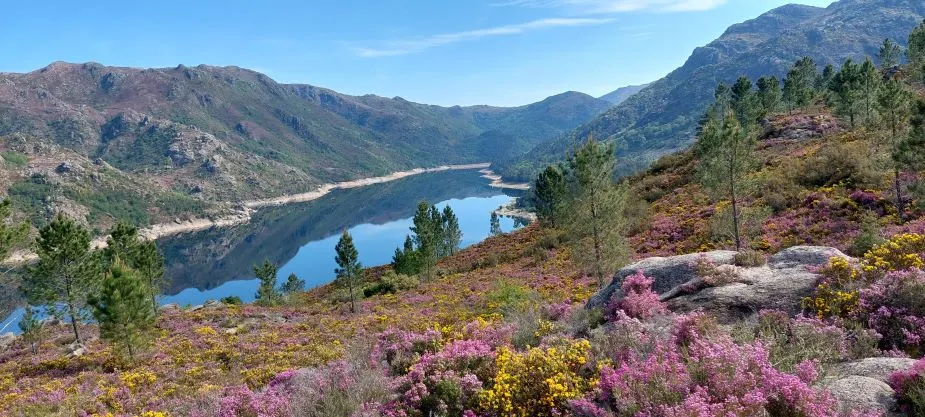
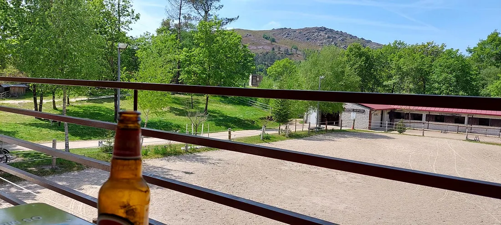
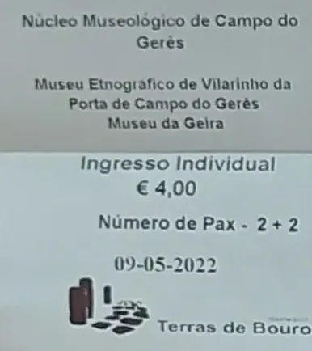

 - [Index](../Index.md)

> 07 a 10 de Maio de 2022

### 🇵🇹 Campo Gerês

Um Lugar bonito e sossegado para viver. Dei uma volta pela aldeia, fiz umas caminhadas pelas serras e também metade de uma Etapa do Caminho de Santiago (da Gueira). Um lugar em que sonhei viver. Imaginei se eu conseguisse lá uma moradia , seria um lugar perfeito para ir até Santiago. Dava para fazer o Caminho duas três vezes por ano.

Analisei as ofertas na Internet, dei uma volta pelas ruelas sonhando descobrir algum objeto para arrendar e procurei lá na Pousada da Juventude se conheciam moradias pequenas, cozinha-sala, quarto para arrendar.

Agora só por 10 meses, porque nos meses de Verão arrendavam aos turistas e tiram tanto ou mais que em dez meses de arrendamento.

_Mais tarde ouvi a mesma argumentação em Sabugueiro, mas eu senti que o Covid19, as mudanças do clima e falta de neve abrandou as expectativas._

Eu procurava um simples e pequeno apartamento ou moradia de 45–60 metros quadrado, por 300–450€ e de preferência com uma pequena garagem, para depois pôr os moveis.

4000 Euros

### 4000 Euros

**Campo Gerês:** Este lugar convidou-me a permanecer, uma percepção muito diferente do Gerês. No Gerês **não** fui no mês de Maio, meu mês preferido, talvez seja este facto a diferença.

Encontrei este Bar/Restaurante , só servem bebidas, o restaurante está fechado, pedi uma cerveja, contemplei o lugar e naquele momento comparti a esplanada com quatro Portugueses, duas mesas distantes de mim. Eu penso que são lá da terra, e também penso que emigraram para lugares diferentes na França. Eles estavam de férias, ou melhor em função da saúde por conta do **_bureau do travail_** que os apoiava com o **_indememnité de Chômage._** Eles, como a maior parte dos portugueses daquela idade que emigraram para as terras gaulesas, já devem carregar, no mínimo, com umas três décadas de Serviço na construção civil. 

Estavam conversando num tom brando, os sussurros das árvores desvendavam-me os segredos das brisas do vento, sons saudáveis que eu sempre procuro.

Do Nada-para-Aqui todo Este-Bem-Estar mudou. Um número que pairou pelo ar, veio desequilibrar a harmonia da Natureza com o Ser-Humano. **4000€!** **4000€!** Sim este foi o número proferido por um deles e foi assim que “**Alguém dos quatro**”, com força na tom da Voz disse, eu estou aqui e estou a receber 4.000€, um “**Outro**” indignado com esta afirmação, num tom ainda mais forte, disse, **como é que estás a receber 4000€ ?** O “**Aquele-dos-4000€**”, num tom baixo e humilde disse, Ah, é durante todo o tempo que estou aqui. O “**Outro**” **Ah Bom**, assim tá bem. Todos eles começaram a desvendar o que estavam a receber, **UM** estava a receber uns 700€ o **Outro** uns 800-e-Poucos, o **Terceiro** recebia perto de 1000€. O **Numero-4** num tom tímido, demorou mais a proferir o que recebia e disse, eu recebo 1200€.

Eu tive a impressão que o **Numero-4** tinha terminado de desvendar um crime que estava a cometer.

O silencio reinou naquele momento e eu calculei, **muito bem,** uns três-quatro meses de cura aérea nestas serras do Gerês é o tempo necessário para se libertarem do Stress provocado pelo encurralamento devido à Covid19 num apartamento apertado em Paris Saint-Denis.

> ***Terminei a cerveja e fui dar mais uma volta, não vi nada, minha mente ficou petrificada naquele lugar, naquele momento tentando decifrar aqueles comportamentos.***

Ah! Portugueses, Portugueses, vós os meninos lindos das Comunidades Europeias na forma como, logo no inicio, lidastes com o Virus da Covid19 que afetou o mundo, esperando que todos os males da vida num mês se extinguissem e não consciente que estás sempre sofrendo do Síndroma-Do-Brasileiro-Rico. Infetados à séculos por aqueles que voltaram do alto mar e com as Patacas de ouro a chocalhar nos bolsos, entravam na Taverna do Zé-Povinho, pagavam os copos, mandavam tocar o bombo e punham o povo a tremelicar. No outro dia, todos eles , os do povo, já estavam contaminados. Com dois tostões no bolso **[1]**, sonhando com as Patacas-de-Ouro no bolso do Brasileiro-Rico, falavam uns para os outros, vou comprar isto, vou comprar aquilo, quero construir aqui, quero construir acolá e ao mesmo tempo queixavam-se da miséria da terra que não dá nada.

Os outros, aqueles que não voltaram, obrigados pelo destino, outras decisões tomaram, foram sacrificados ao mar ou a selva os assimilou, e à Terra Natal nunca mais voltaram. Foram esquecidos, não contaminaram e os nomes não foram história.

O Português, com o O Síndroma-do-Brasileiro-Rico, que voltou do Alto-Mar ou de Além-Fronteiras, o nome não é história, é uma abstração como outras; “**O-Americano**”, este é no Continente desconhecido, mas nos Açores muito famoso; “**O Brasileiro**” da terra prometida, antes poucos voltaram, agora todos querem vir; “**O Francês**” um ano esperava, no mês de Agosto voltava, soletra duas palavras imitando Voltaire, era aquilo que não era, e antes de partir prometia voltar e agora já não sabe onde é terra no país estranho dos antecedentes; “**O Alemão**”, lá, não se compreende nada, o Marco é forte, devesse ganhar bem, mas ouvi falar que aquilo lá mudou muito; **“O Suíço”** esse graças à proeza do povo **Helvético que** construiu Caminhos nas montanhas mais altas e nos vales mais escondidos, esse **“Suíço”** é o mais contemporâneo com o O Síndroma-do-Brasileiro-Rico. Com boas vias transitórias, e bons carros ainda anda no Vai-Vem, proliferando esse Virus que transforma o cérebro dos de cá, numa massa bruta em que o raciocínio só consegue refletir símbolos dos Dólares e espelhando-os nos olhos.

> ***Estes nomes abstratos sem história já não têm aquele brilho incandescente de outrora.***

---

Tudo muda, e com o agravamento do clima mundial, cada vez se vêem mais vias obstruídas por desabamento das montanhas, de terra, não de neve! Aquelas histórias, que se contavam na Taberna do Zé-Povinho ao Tio-Manel-da-Serra, brindando à saúde com um copo de vinho tirado fresquinho da pipa e acompanhado com uns tremoços, vão passar a ser Seemannsgarn „Histórias de Marinheiro“ .

> O tempo passa, o calor aperta, o branco no topo das montanhas desaparece e com a distancia do tempo, as Histórias do Marinheiro da Montanha que alguém anotou num papel,

> “_Eu lá, com aquele frio, que congela os dedos, tenha que me levantar às 4 da madrugada para abrir os caminhos atolados pelas avalanches e grandes quedas de neve. Ai! O que se lá sofre!”_

> vão deixar de ser Seemannsgarn e passar a ser uma Legenda-de-Fadas dos Bons-Velhos-Tempos.

---

Antigamente viver nesses países era bom, e quando nevava muito, não se trabalhava, mas com o “Indemnité mauvais temps” e o abono de Família já dava para fazer aqui uma casa. **[2]**

O dinheiro lá tinha muito mais valor, 1 Marco, 1 Franco dava para pagar os copos à aldeia toda, aqui o dinheiro não valia nada.

Ai! Agora “Aqueles-dos-Outros-Países” vão para lá tem um monte de filhos só para receber apoio do Estado e não fazem nada. Nós não, nós fomos para lá mas trabalhávamos. Aquilo já foi, agora também já não dá nada.

> Aqui no nosso cantinho não se ganha muito, ai mas só o sossego**[3]** já vale tudo.

Agora o Povo-dos-Brandos-Costumes, apoiados pelas Agências profissionais Imobiliárias, transformam morros cheios de carrascos e ruínas habitadas por corujas, em verdadeiras minas de ouro. Usam as novas tecnologias e nas paginas da Internet, dão brilho ofuscante aos objetos expostos. Sim! Existe ouro sim, mas muito dele é falso como as frases, “Vou comprar isto, vou comprar aquilo” e só com dois tostões no bolso roto.

#### Bons conselhos

**[1]** E com os bolsos vazios ainda sobra sempre alguma coisinha para o próximo, sugestões que não custam nada mas de um valor incalculável para o “Outro”.

Usamos aquele altruísmo retórico que fomos aprendendo com o soletrar das palavras. “Eu se fosse a você, aqui fazia assim, e ali daquela maneira. E se algum se deixou ajudar, influenciar, manipular e no fim deu certo. Ah, fui eu que lhe disse para fazer assim, e daquela outra maneira. Se não deu certo, então repelem todas as responsabilidades como um vírus contagioso, expirando palavras imunológicas, auto-protegendo-se dizendo, não era assim que você devia ter feito, então você não sabe que aqui não se pode fazer assim, mas sim daquela outra maneira.

#### Casas dos anos 80

> - O arquiteto precisava apenas de uma folha A3, um lápis e uma régua; não era preciso mais nada – voilà, e já estavam prontas as plantas das casas.

**[2]** Casa: Uma caixa com vários compartimentos eletrificados, dois deles com água canalizada, a cozinha e o banho, com predestinação para apanhar caruncho "fungos". Luxo para aquele tempo e no verão, quando não há água, a canalização dá a sensação de sermos mais civilizados, modernos e superiores áqueles que viviam nas casas de granito iluminadas com lanternas a petróleo , onde na lareira a lenha se cozinhava … , muitos tinham que ir a pé à fonte do povo, buscar água com os cântaros, os mais civilizados-motorizados, os avecs, ex-avecs e os **Eu-Não-Precisei-de-Ir-ao-Estrangeiro-para-Ter-Carro**, iam de calhambeque , levavam a mala cheia de vasilhas para encher e as velhotas lá da terra tinham que se pôr na fila se queriam matar a cede depois de uma manhã na lavoura.

#### O sossego miserável

**[3]** O sossego também dói e quando os bolsos estão rotos devidos aos efeitos secundários do dinheiro que se gastou na farmácia para os muitos medicamentos que o medico receitou e para a imensidão de analises clínicas que foram feitas, então a miséria retórica é a conduta absoluta da vida.

---

### 🇪🇸 Campo Gerês

Un lugar bonito y tranquilo para vivir. Di una vuelta por el pueblo, hice algunas rutas de senderismo por las sierras y también recorrí la mitad de una etapa del Camino de Santiago (de Gueira). Un lugar en el que soñaba con vivir. Me imaginé que, si consiguiera una vivienda allí, sería un lugar perfecto para ir hasta Santiago. Podría hacer el Camino dos o tres veces al año.

Analicé las ofertas en Internet, di una vuelta por las callejuelas soñando con encontrar algún piso para alquilar y pregunté en el Albergue Juvenil si sabían de alguna vivienda pequeña, con cocina-salón y un dormitorio, que se pudiera alquilar.

Pero solo durante 10 meses, porque en los meses de verano los alquilan a turistas y sacan tanto o más que en diez meses de alquiler.

Más tarde escuché el mismo argumento en Sabugueiro, pero tuve la sensación de que la COVID-19, los cambios climáticos y la falta de nieve habían moderado las expectativas.

Buscaba un apartamento o una vivienda sencilla y pequeña, de entre 45 y 60 metros cuadrados, por entre 300 y 450 €, y preferiblemente con un pequeño garaje, para poder poner luego los muebles.

4000 Euros

### 4000 euros

**Campo Gerês:** Este lugar me invitó a quedarme, una sensación muy diferente a la de Gerês. En Gerês **no** fui en mayo, mi mes favorito; quizá esa sea la diferencia.

Encontré este bar-restaurante; solo sirven bebidas, el restaurante está cerrado. Pedí una cerveza, contemplé el lugar y, en ese momento, compartí la terraza con cuatro portugueses, sentados en dos mesas alejadas de mí. Creo que son de por allí, y también creo que emigraron a diferentes lugares de Francia. Estaban de vacaciones, o mejor dicho, de baja por motivos de salud a cargo de la **_bureau du travail_**, que les proporcionaba la **_indemnité de chômage_**. Ellos, como la mayoría de los portugueses de esa edad que emigraron a tierras galas, ya deben de llevar, como mínimo, unas tres décadas trabajando en la construcción. Hablaban en voz baja; los susurros de los árboles me desvelaban los secretos de la brisa, esos sonidos reconfortantes que siempre busco.

---

#### De la nada a aquí

De la nada a aquí, todo este bienestar ha cambiado. Una cifra que flotaba en el aire vino a desequilibrar la armonía entre la naturaleza y el ser humano. **¡4000 €!** **¡4000 €!** Sí, ese fue el número que pronunció uno de ellos y así fue como «**uno de los cuatro**», con fuerza en el tono de su voz, dijo: «Estoy aquí y estoy cobrando 4000 €». «**Otro**», indignado por esta afirmación, en un tono aún más enérgico, dijo: **«¿Cómo es que estás recibiendo 4.000 €?»** El «**Aquel de los 4.000 €**», en un tono bajo y humilde, respondió: «Ah, es por todo el tiempo que llevo aquí». El «**Otro**»: **«Ah, vale**, entonces está bien». Todos empezaron a revelar lo que ganaban: **UNO** ganaba unos 700 €, el **Otro** unos 800 y pico, y el **Tercero** ganaba cerca de 1 000 €. El **Número 4**, en un tono tímido, tardó más en decir lo que ganaba y dijo: «Yo gano 1200 €».

Tuve la impresión de que el **Número 4** acababa de confesar un delito que estaba cometiendo.

En ese momento reinó el silencio y calculé: **muy bien,** unos tres o cuatro meses de cura al aire libre en estas montañas del Gerês es el tiempo necesario para liberarse del estrés provocado por el confinamiento debido a la COVID-19 en un apartamento estrecho de París-Saint-Denis.

> ***Me terminé la cerveza y salí a dar otra vuelta; no vi nada, mi mente se quedó paralizada en aquel lugar, en aquel momento, intentando descifrar aquellos comportamientos.***

---

¡Ah! Portugueses, portugueses, vosotros, los niños bonitos de las Comunidades Europeas, por la forma en que, desde el principio, afrontasteis el virus de la COVID-19 que afectó al mundo, esperando que todos los males de la vida se extinguieran en un mes y sin daros cuenta de que siempre padecéis el «síndrome del brasileño rico». Contagiados desde hace siglos por aquellos que regresaban de alta mar con las patacas de oro tintineando en los bolsillos, entraban en la taberna de Zé-Povinho, pagaban las copas, mandaban tocar el bombo y hacían que la gente se pusiera a bailar. Al día siguiente, todos ellos, la gente del pueblo, ya estaban contagiados. Con dos céntimos en el bolsillo **[1]**, soñando con las patacas de oro en el bolsillo del «brasileño rico», se decían unos a otros: «Voy a comprar esto, voy a comprar aquello, quiero construir aquí, quiero construir allá», y al mismo tiempo se quejaban de la miseria de la tierra que no da nada.

Los demás, aquellos que no regresaron, obligados por el destino, tomaron otras decisiones: fueron víctimas del mar o la selva los absorbió, y nunca más volvieron a su tierra natal. Quedaron en el olvido, no contagiaron a nadie y sus nombres no pasaron a la historia.

---

El portugués, con el «síndrome del brasileño rico», que ha regresado de alta mar o de más allá de las fronteras; el nombre no importa, es una abstracción como cualquier otra; «**El americano**», desconocido en el continente, pero muy famoso en las Azores; «**El brasileño**» de la tierra prometida: antes pocos regresaban, ahora todos quieren venir; «**El francés**» esperaba un año, en agosto regresaba, deletreaba dos palabras imitando a Voltaire, era lo que no era, y antes de partir prometía volver y ahora ya no sabe dónde está su tierra en el país extraño de sus antepasados; «**El alemán**»: allí no se entiende nada; el marco es fuerte, debería ganar bien, pero he oído que las cosas han cambiado mucho por allí; **«El suizo»**, ese, gracias a la hazaña del pueblo **helvético que** construyó caminos en las montañas más altas y en los valles más recónditos, ese **«suizo»** es el que más se identifica con el síndrome del brasileño rico. A  contar con buenas vías de tránsito y buenos coches, sigue en el «vaivén», proliferando ese virus que transforma el cerebro de los de aquí en una masa bruta en la que el razonamiento solo es capaz de reflejar símbolos de dólares y reflejarlos en los ojos.

> ***Estes nomes abstratos sem história já não têm aquele brilho incandescente de outrora.***

---

Todo cambia, y con el empeoramiento del clima mundial, cada vez se ven más carreteras cortadas por desprendimientos de las montañas, ¡de tierra, no de nieve! Esas historias, que se contaban en la Taberna de Zé-Povinho al Tío-Manel-da-Serra, brindando por la salud con una copa de vino recién sacado del barril y acompañadas de unas habas, pasarán a ser «Seemannsgarn» («Historias de marinero»).

> El tiempo pasa, el calor aprieta, el blanco de las cimas de las montañas desaparece y, con el paso del tiempo, las «Historias del marinero de la montaña» que alguien anotó en un papel,

> «_Allí, con ese frío que te congela los dedos, tengo que levantarme a las 4 de la madrugada para despejar los caminos obstruidos por las avalanchas y las grandes nevadas. ¡Ay! ¡Lo que se sufre allí!»_

> dejarán de ser «Seemannsgarn» y se convertirán en una leyenda de hadas de los buenos viejos tiempos.

---

Antes, vivir en esos países era bueno, y cuando nevaba mucho, no se trabajaba, pero con la «Indemnité mauvais temps» y el subsidio familiar ya daba para construirse una casa aquí. **[2]**

El dinero allí tenía mucho más valor: con 1 marco o 1 franco se podían pagar las copas a todo el pueblo; aquí el dinero no valía nada.

¡Ay! Ahora «los de esos otros países» se van allí, tienen un montón de hijos solo para recibir ayudas del Estado y no hacen nada. Nosotros no, nosotros nos fuimos allí, pero trabajábamos. Eso ya pasó, ahora tampoco da nada.

> Aquí, en nuestro rinconcito, no se gana mucho, pero la tranquilidad **[3]** ya lo compensa todo.

Ahora, la Gente-de-Costumbres-Suaves, con el apoyo de las agencias inmobiliarias profesionales, transforma colinas llenas de escombros y ruinas habitadas por lechuzas en auténticas minas de oro. Utilizan las nuevas tecnologías y, en las páginas de Internet, dan un brillo deslumbrante a los objetos expuestos. ¡Sí! Hay oro, sí, pero gran parte de él es falso, como las frases «Voy a comprar esto, voy a comprar aquello», y eso que solo tienes dos céntimos en el bolsillo roto.

---

#### Buenos consejos

**[1]** Y, aunque tengamos los bolsillos vacíos, siempre sobra algo para el prójimo: sugerencias que no cuestan nada, pero que tienen un valor incalculable para el «otro».

Recurrimos a ese altruismo retórico que hemos ido aprendiendo al deletrear las palabras. «Si yo fuera tú, aquí haría esto, y allí aquello». Y si alguno se dejó ayudar, influir o manipular y al final salió bien: «Ah, fui yo quien te dijo que lo hicieras así y de esa otra manera». Si no salió bien, entonces rechazan toda responsabilidad como si fuera un virus contagioso, exhalando palabras inmunitarias, protegiéndose a sí mismos diciendo: «No era así como debías haberlo hecho; ¿es que no sabes que aquí no se puede hacer así, sino de esa otra manera?».

---

#### Casas de los años 80

> - El arquitecto solo necesitaba una hoja de tamaño A3, un lápiz y una regla; no hacía falta nada más: voilà, y ya estaban listos los planos de la casa.

**[2]** Casa: Una caja con varios compartimentos electrificados, dos de ellos con agua corriente, la cocina y el baño, propicios para la aparición de hongos. Todo un lujo para aquella época y, en verano, cuando no hay agua, la canalización nos da la sensación de ser más civilizados, modernos y superiores a aquellos que vivían en casas de granito iluminadas con lámparas de petróleo, donde se cocinaba con leña en la chimenea…; muchos tenían que ir a pie a la fuente del pueblo a buscar agua con jarras, los más civilizados —los que tenían coche—, los «avecs», los «ex-avecs» y los **«Yo-no-necesité-ir-al-extranjero-para-tener-coche»**, iban en cacharros, llevaban la maleta llena de recipientes para llenar y las ancianas del pueblo tenían que ponerse a la cola si querían saciar su sed tras una mañana en el campo.

---

#### Una tranquilidad miserable

**[3]** La tranquilidad también duele y, cuando los bolsillos están vacíos debido a los efectos secundarios del dinero que se ha gastado en la farmacia en los numerosos medicamentos que el médico ha recetado y en la inmensidad de análisis clínicos que se han realizado, entonces la miseria retórica es la norma absoluta de la vida.

---

### 🇩🇪 Campo Gerês

Ein schöner und ruhiger Ort zum Leben. Ich habe einen Rundgang durch das Dorf gemacht, bin in den Bergen gewandert und habe auch die Hälfte einer Etappe des Jakobswegs (von Gueira aus) zurückgelegt. Ein Ort, an dem ich davon geträumt habe, zu leben. Ich stellte mir vor, wenn ich dort eine Wohnung finden könnte, wäre es der perfekte Ausgangspunkt, um nach Santiago zu pilgern. Man könnte den Jakobsweg zwei- bis dreimal im Jahr gehen.

Ich habe mir die Angebote im Internet angesehen, bin durch die Gassen geschlendert und habe davon geträumt, etwas zum Mieten zu finden, und habe in der Jugendherberge nachgefragt, ob sie kleine Wohnungen mit Wohnküche und einem Schlafzimmer zur Vermietung kennen.

Allerdings nur für 10 Monate, denn in den Sommermonaten vermieten sie an Touristen und nehmen dabei genauso viel oder sogar mehr ein als in zehn Monaten Miete.

Später hörte ich dieselben Argumente in Sabugueiro, aber ich hatte den Eindruck, dass Covid-19, der Klimawandel und der Schneemangel die Erwartungen gedämpft hatten.

Ich suchte nach einer einfachen, kleinen Wohnung oder einem Häuschen mit 45–60 Quadratmetern für 300–450 € und vorzugsweise mit einer kleinen Garage, um später die Möbel unterzubringen.

4000 Euro 

### 4000 Euro

**Campo Gerês:** Dieser Ort hat mich dazu eingeladen, zu bleiben – ein ganz anderes Erlebnis als im Gerês. Im Gerês war ich **nicht** im Mai, meinem Lieblingsmonat; vielleicht macht genau das den Unterschied aus.

Ich habe diese Bar/dieses Restaurant entdeckt – dort werden nur Getränke serviert, das Restaurant ist geschlossen. Ich bestellte ein Bier, betrachtete den Ort und teilte mir in diesem Moment die Terrasse mit vier Portugiesen, die zwei Tische von mir entfernt saßen. Ich glaube, sie stammen aus der Gegend, und ich glaube auch, dass sie in verschiedene Orte in Frankreich ausgewandert sind. Sie waren im Urlaub – oder besser gesagt, sie befanden sich aus gesundheitlichen Gründen in einer Arbeitsunfähigkeitsphase, die vom **_Bureau du Travail_** unterstützt wurde, das ihnen die **_Indemnité de Chômage_** zahlte. Wie die meisten Portugiesen dieses Alters, die in die gallischen Gefilde ausgewandert sind, dürften sie bereits mindestens drei Jahrzehnte Berufserfahrung im Baugewerbe vorweisen können. 

*Sie unterhielten sich in leisem Ton, das Rauschen der Bäume enthüllte mir die Geheimnisse der sanften Brise – wohltuende Klänge, nach denen ich immer wieder suche.*

---

#### Aus dem Nichts zum Hierher 

Aus dem Nichts zum Hierher hat sich dieses ganze Wohlbefinden verändert. Eine Zahl, die in der Luft lag, brachte die Harmonie zwischen der Natur und dem Menschen aus dem Gleichgewicht. **4000 €!** **4000 €!** Ja, das war die Zahl, die einer von ihnen aussprach, und so sagte „**einer der vier**“ mit fester Stimme: „Ich bin hier und bekomme 4.000 €.“ Ein „**anderer**“, empört über diese Aussage, sagte mit noch festerer Stimme: **„Wie kommst du darauf, 4.000 € zu bekommen?“** Der „**Der mit den 4.000 €**“ antwortete mit leiser, bescheidener Stimme: „Ach, das bekomme ich, solange ich hier bin.“ Der „**Andere**“: **„Ah, gut**, dann ist ja alles in Ordnung.“ Alle fingen an, zu verraten, was sie erhielten: **Einer** bekam etwa 700 €, der **Andere** etwas über 800 €, der **Dritte** erhielt fast 1.000 €. Der **Vierte** zögerte in schüchternem Ton etwas länger, bevor er sagte, was er bekam, und meinte: „Ich bekomme 1200 €.“

Ich hatte den Eindruck, dass der **Vierte** gerade ein Verbrechen verraten hatte, das er selbst begangen hatte.

In diesem Moment herrschte Stille, und ich rechnete mir aus: **Na gut,** etwa drei bis vier Monate Erholung in der Bergluft dieser Gerês-Berge sind die Zeit, die nötig ist, um sich von dem Stress zu befreien, der durch die Covid-19-bedingte Enge in einer beengten Wohnung in Paris-Saint-Denis verursacht wurde.

**Ich trank mein Bier aus** und machte noch einen Spaziergang; ich sah nichts, meine Gedanken waren an diesem Ort, in diesem Moment wie erstarrt und versuchten, dieses Verhalten zu entschlüsseln.

---

Ach! Portugiesen, Portugiesen, ihr liebenswerten Kinder der Europäischen Gemeinschaften, so wie ihr gleich zu Beginn mit dem Covid-19-Virus umgegangen seid, das die Welt heimgesucht hat – in der Hoffnung, dass alle Übel des Lebens innerhalb eines Monats verschwinden würden, und ohne zu begreifen, dass ihr stets unter dem „Syndrom des reichen Brasilianers“ leidet. Seit Jahrhunderten infiziert von jenen, die von der hohen See zurückkehrten und mit klimpernden Gold-Patacas in den Taschen die „Taverna do Zé-Povinho“ betraten, die Gläser bezahlten, die Trommel schlagen ließen und das Volk zum Beben brachten. Am nächsten Tag waren sie alle, das Volk, bereits angesteckt. Mit zwei Groschen in der Tasche **[1]**, träumend von den Gold-Patacas in der Tasche des reichen Brasilianers, sagten sie zueinander: „Ich werde dies kaufen, ich werde jenes kaufen, ich will hier bauen, ich will dort bauen“, und gleichzeitig beklagten sie sich über das Elend des Landes, das nichts hergibt.

Die anderen, jene, die nicht zurückkehrten, vom Schicksal dazu gezwungen, trafen andere Entscheidungen; sie fielen dem Meer zum Opfer oder wurden vom Dschungel verschlungen und kehrten nie wieder in ihre Heimat zurück. Sie gerieten in Vergessenheit, haben nichts angesteckt, und ihre Namen gingen nicht in die Geschichte ein.

---

Der Portugiese mit dem „Syndrom des reichen Brasilianers“, der von der hohen See oder aus dem Ausland zurückgekehrt ist – der Name spielt keine historische Rolle, sondern ist eine Abstraktion wie andere auch; „**Der Amerikaner**“, dieser ist auf dem Kontinent unbekannt, auf den Azoren jedoch sehr berühmt; „**Der Brasilianer**“ aus dem gelobten Land – früher kehrten nur wenige zurück, jetzt wollen alle kommen; „**Der Franzose**“ wartete ein Jahr, kehrte im August zurück, buchstabierte zwei Wörter und ahmte Voltaire nach, war das, was er nicht war, und versprach vor seiner Abreise, zurückzukommen, und jetzt weiß nun nicht mehr, wo sein Zuhause in dem fremden Land seiner Vorfahren ist; „**Der Deutsche**“ – dort versteht man nichts, die D-Mark ist stark, man sollte gut verdienen, aber ich habe gehört, dass sich dort vieles geändert hat; **„Der Schweizer“** – dank der Heldentat des **helvetischen Volkes**, das Wege in den höchsten Bergen und in den verstecktesten Tälern angelegt hat, ist dieser **„Schweizer“**, das zeitgemäßeste Beispiel für das „Syndrom des reichen Brasilianers“

Mit guten Verbindungsstraßen und guten Autos fährt er immer noch hin und her und verbreitet dabei diesen Virus, der das Gehirn der Menschen hier in eine grobe Masse verwandelt, in der das Denken nur noch Dollarzeichen widerspiegeln und diese in den Augen reflektieren lässt.

> ***Diese abstrakten Namen ohne Geschichte haben nicht mehr jenen glühenden Glanz von einst.***

---

Alles ändert sich, und mit der Verschlechterung des weltweiten Klimas sieht man immer häufiger Straßen, die durch Erdrutsche in den Bergen blockiert sind – durch Erde, nicht durch Schnee! Diese Geschichten, die man in der Taverne von Zé-Povinho dem Onkel Manel-da-Serra erzählte, während man mit einem Glas Wein, frisch aus dem Fass, und ein paar Lupinen auf die Gesundheit anstieß, werden fortan zu „Seemannsgarn“ – „Geschichten eines Seemanns“.

> Die Zeit vergeht, die Hitze nimmt zu, das Weiß auf den Berggipfeln verschwindet, und mit dem Abstand der Zeit werden die Geschichten des Bergseemanns, die jemand auf Papier notiert hat,

> „_Ich dort, bei dieser Kälte, die einem die Finger gefrieren lässt, muss um 4 Uhr morgens aufstehen, um die durch Lawinen und starken Schneefall versperrten Wege freizuräumen. Ach! Was man dort alles erdulden muss!“_

> werden kein Seemannsgarn mehr sein, sondern zu einer Märchengeschichte aus der guten alten Zeit.

---

Früher war das Leben in diesen Ländern gut, und wenn es stark schneite, wurde nicht gearbeitet, aber mit der „Indemnité mauvais temps“ und dem Kindergeld reichte es schon aus, um sich hier ein Haus zu bauen. **[2]**

Das Geld hatte dort viel mehr Wert: Mit 1 Mark oder 1 Franc konnte man dem ganzen Dorf einen Umtrunk ausgeben, hier war das Geld nichts wert.

Ach! Jetzt gehen „die aus den anderen Ländern“ dorthin, bekommen eine Menge Kinder, nur um staatliche Unterstützung zu erhalten, und tun nichts. Wir nicht, wir sind zwar dorthin gegangen, aber wir haben gearbeitet. Das ist vorbei, jetzt bringt es auch nichts mehr.

> Hier in unserer kleinen Ecke verdient man nicht viel, aber allein die Ruhe**[3]** ist schon alles wert.

Jetzt verwandeln die „Leute mit den sanften Sitten“, unterstützt von professionellen Immobilienagenturen, Hügel voller Schrott und Ruinen, die von Eulen bewohnt werden, in wahre Goldgruben. Sie nutzen die neuen Technologien und verleihen den angebotenen Objekten auf den Internetseiten einen blendenden Glanz. Ja! Es gibt tatsächlich Gold, aber vieles davon ist falsch, genau wie die Sprüche „Ich kaufe dies, ich kaufe das“, obwohl man nur zwei Groschen in der durchlöcherten Hosentasche hat.

---

#### Gute Ratschläge

**[1]** Und selbst wenn die Taschen leer sind, bleibt immer noch etwas für den Nächsten übrig – Ratschläge, die nichts kosten, aber für den „Anderen“ von unschätzbarem Wert sind.

Wir bedienen uns jener rhetorischen Selbstlosigkeit, die wir schon beim Buchstabieren der Wörter gelernt haben. „Wenn ich an deiner Stelle wäre, würde ich hier so vorgehen und dort auf jene Weise. Und wenn sich jemand helfen, beeinflussen oder manipulieren ließ und es am Ende geklappt hat: ‚Ach, ich war es doch, der dir gesagt hat, du sollst es so und auf jene andere Weise machen.‘ Wenn es nicht geklappt hat, schieben sie alle Verantwortung wie einen ansteckenden Virus von sich, spucken immunologische Worte aus und schützen sich selbst, indem sie sagen: ‚So hättest du es nicht machen sollen, du weißt doch, dass man es hier nicht so machen darf, sondern auf jene andere Weise.‘

---

#### Häuser aus den 80er Jahren

> - Der Architekt brauchte lediglich ein Blatt A3, einen Bleistift und ein Lineal; mehr war nicht nötig – voilà, schon waren die Hauspläne fertig.

**[2]** Haus: Ein Kasten mit mehreren elektrifizierten Räumen, von denen zwei über fließendes Wasser verfügen – die Küche und das Badezimmer –, die geradezu dazu prädestiniert sind, Schimmel "caruncho" zu bilden. Für damalige Verhältnisse ein Luxus, und im Sommer, wenn es kein Wasser gibt, vermittelt die Wasserleitung das Gefühl, zivilisierter, moderner und denen überlegen zu sein, die in Granithäusern lebten, die mit Petroleumlampen beleuchtet wurden und in denen am Kamin mit Brennholz gekocht wurde … Viele mussten zu Fuß zur Dorfquelle gehen, um mit Krügen Wasser zu holen, die zivilisierteren – die Motorisierten, die „Avecs“, die ehemaligen „Avecs“ und die **„Ich-musste-nicht-ins-Ausland-gehen-um-ein-Auto-zu-haben“** – fuhren mit der Klapperkiste hin, nahmen einen Koffer voller Gefäße zum Befüllen mit und die alten Frauen vom Land mussten sich in die Schlange stellen, wenn sie nach einem Vormittag auf dem Feld ihren Durst stillen wollten.

---

#### Elende Stille

**[3]** Auch die Stille tut weh, und wenn die Geldbeutel leer sind aufgrund der Nebenwirkungen des Geldes, das in der Apotheke für die vielen vom Arzt verschriebenen Medikamente und für die Unmenge an klinischen Untersuchungen ausgegeben wurde, dann ist das rhetorische Elend die absolute Lebensweise.

---

### 🇬🇧 Campo Gerês

A beautiful and peaceful place to live. I had a wander round the village, went for a few walks in the hills and also completed half a stage of the Way of St James (from Gueira). A place I’d dreamt of living in. I imagined that if I could find a flat there, it would be the perfect place from which to set off for Santiago. I could do the Way two or three times a year.

I looked through the listings online, wandered through the narrow streets dreaming of finding somewhere to rent, and asked at the Youth Hostel if they knew of any small flats – a kitchen-diner and a bedroom – available to let.

But only for 10 months, because during the summer months they rent them out to tourists and make as much, if not more, than they would from ten months’ rent.

Later, I heard the same argument in Sabugueiro, but I felt that Covid-19, climate change and the lack of snow had dampened expectations.

I was looking for a simple, small flat or house of 45–60 square metres, for €300–450, and preferably with a small garage, so I could move my furniture in later

4,000 euros

### 4,000 euros

**Campo Gerês:** This place made me want to stay – a very different impression from Gerês. I **didn’t** visit Gerês in May, my favourite month; perhaps that’s what makes the difference.

I came across this bar/restaurant; they only serve drinks – the restaurant is closed. I ordered a beer, took in the surroundings, and at that moment shared the terrace with four Portuguese people, sitting at two tables some distance away from me. I reckon they’re locals, and I also reckon they’ve emigrated to different parts of France. They were on holiday, or rather on sick leave through the **_bureau du travail_**, which was supporting them with **_indemnité de chômage_**. Like most Portuguese people of that age who have emigrated to Gaul, they must already have at least three decades’ service in the building trade under their belts. 

They were chatting in soft tones; the whispers of the trees revealed to me the secrets of the gentle breezes – soothing sounds that I always seek out.

#### From Nothing to Here

From Nothing to Here, all this Well-being has changed. A figure that hung in the air came to upset the harmony between Nature and humankind. **€4,000!** **€4,000!** Yes, this was the figure uttered by one of them, and that was how “**one of the four**”, speaking in a forceful tone, said, “I am here and I am receiving €4,000.” An “**other**”, indignant at this statement, said in an even stronger tone, **‘How on earth are you getting 4,000€?’** The “**One-with-the-4,000€**”, in a low and humble tone, said, ‘Ah, it’s for the whole time I’m here.’ The “**Other**” said, **“Ah, right**, that’s fine then.” They all began to reveal what they were earning: **ONE** was earning around €700, the **Other** a little over €800, and the **Third** was earning close to €1,000. **Number 4**, in a shy tone, took longer to say how much he was receiving and said, “I get 1,200 euros.”

I got the impression that **Number 4** had just confessed to a crime he was committing.

Silence reigned at that moment and I reckoned, **very well,** three or four months of fresh air in these Gerês mountains is the time needed to free themselves from the stress caused by being cooped up due to Covid-19 in a cramped flat in Paris Saint-Denis.

*I finished my beer and went for another walk; I saw nothing, but my mind remained transfixed in that place, at that moment, trying to make sense of those behaviours.*

---

Ah! Portuguese, Portuguese, you are the darlings of the European Communities for the way in which, right from the start, you dealt with the Covid-19 virus that affected the world, hoping that all of life’s woes would be wiped out in a month and unaware that you are always suffering from ‘Rich Brazilian Syndrome’. Infected for centuries by those who returned from the high seas, with gold patacas jingling in their pockets, they’d walk into Zé-Povinho’s Tavern, pay for their drinks, have the drum beaten, and set the people quivering. By the next day, all of them—the common folk—were already infected. With two pennies in their pockets **[1]**, dreaming of the gold patacas in the Rich Brazilian’s pocket, they’d say to one another, ‘I’m going to buy this, I’m going to buy that, I want to build here, I want to build there,’ whilst at the same time complaining about the misery of the land that yields nothing.

The others—those who did not return, compelled by fate—made different choices; they were lost at sea or swallowed up by the jungle, and never returned to their homeland. They were forgotten; they did not spread the contagion, and their names did not go down in history.

---

The Portuguese man, suffering from ‘Rich Brazilian Syndrome’, who has returned from the high seas or from beyond the borders – the name is not history, but an abstraction like any other; ‘**The American**’, unknown on the mainland but very famous in the Azores; ‘**The Brazilian**’ from the promised land – once few returned, now everyone wants to come; “**The Frenchman**” waited a year, returned in August, spelt out two words imitating Voltaire, was something he wasn’t, and before leaving promised to return, yet now no longer knows where he stands in the strange land of his ancestors; “**The German**”—over there, one understands nothing; the mark is strong, he ought to be earning well, but I’ve heard that things have changed a great deal over there; **“The Swiss”**—thanks to the feat of the **Helvetic** people who built paths through the highest mountains and the most hidden valleys—this **“Swiss”** is the one most in tune with the Rich-Brazilian Syndrome. With good access roads and good cars, he still goes back and forth, spreading this virus that transforms the brains of the locals into a mindless mass where reasoning can only reflect images of dollar signs, mirrored in their eyes.

These abstract names, devoid of history, no longer possess that incandescent glow of yesteryear.

---

Everything changes, and as the global climate worsens, we’re seeing more and more roads blocked by landslides – landslides of earth, not snow! Those stories, which were told at Zé-Povinho’s Tavern to Uncle Manel-da-Serra, whilst toasting to good health with a glass of wine straight from the cask and accompanied by some lupin beans, will now become ‘Seemannsgarn’ – ‘Sailor’s Tales’.

***Time passes, the heat intensifies, the white on the mountain tops disappears, and as time goes by, the ‘Stories of the Mountain Sailor’ that someone jotted down on a piece of paper,***

> “_There I am, in that cold that freezes your fingers, having to get up at 4 o’clock in the morning to clear the paths blocked by avalanches and heavy snowfalls. Oh! The suffering one endures there!”_

***will cease to be Seemannsgarn and become a Fairy Tale of the Good Old Days.***

---

In the old days, life in those countries was good, and when it snowed heavily, we didn’t have to work, but with the ‘Indemnité mauvais temps’ and the family allowance, it was enough to build a house here. **[2]**

Money was worth much more over there; 1 Mark or 1 Franc was enough to buy drinks for the whole village, whereas here money was worth nothing.

Oh dear! Now ‘those people from other countries’ go there, have loads of children just to get state benefits, and do nothing. Not us – we went there, but we worked. Those days are gone; it’s no use now either.

> Here in our little corner, you don’t earn much, but just the peace and quiet**[3]** is worth it all.

Now the People-of-Mild-Customs, backed by professional estate agents, are turning hillsides full of derelict buildings and ruins inhabited by owls into veritable gold mines. They use new technologies and, on their websites, make the properties on display look dazzlingly attractive. Yes! There really is gold, but much of it is as fake as the phrases, ‘I’m going to buy this, I’m going to buy that’ – whilst having only a couple of pennies in a threadbare pocket.

---

#### Good advice

**[1]** And even with empty pockets, there’s always a little something left over for the next person – suggestions that cost nothing but are of incalculable value to the ‘Other’.

We resort to that rhetorical altruism we’ve learnt as we’ve learnt to spell words. ‘If I were you, I’d do it this way here, and that way over there. And if anyone let themselves be helped, influenced or manipulated, and in the end it worked out, ‘Ah, it was me who told you to do it this way, and that other way.’ If it didn’t work out, then they shunt all responsibility aside like a contagious virus, exhaling ‘immune’ words, protecting themselves by saying, ‘That’s not how you should have done it; don’t you know that here you can’t do it this way, but rather that other way?’

---

#### Houses from the 1980s

> - All the architect needed was a sheet of A3 paper, a pencil, and a ruler; that was all it took—and voilà, the house plans were ready.

**[2]** House: A box with several electrified rooms, two of which have running water – the kitchen and the bathroom – and which are bound to become breeding grounds for mould. A luxury for those times, and in summer, when there is no water, the piped water gives the impression that we are more civilised, modern and superior to those who lived in granite houses lit by paraffin lamps, where firewood was used for cooking in the hearth …; many had to walk to the village well to fetch water in jugs, the more ‘civilised’ motorised folk – the ‘avecs’, ex-‘avecs’ and the **‘I-Didn’t-Need-to-Go-Abroad-to-Get-a-Car’** types – would set off in their old bangers, taking a bag full of containers to fill, whilst the old ladies from the village had to queue up if they wanted to quench their thirst after a morning in the fields.

---

#### Miserable tranquillity

**[3]** Peace and quiet can also be painful, and when your pockets are empty due to the knock-on effects of the money spent at the chemist’s on the many medicines the doctor prescribed and the countless clinical tests that were carried out, then rhetorical misery becomes the absolute reality of life.

---

---

### ➢

↪ [20220510-12_Guarda](20220510-12_Guarda.md)

↪ [Index](../Index.md)

 ...→