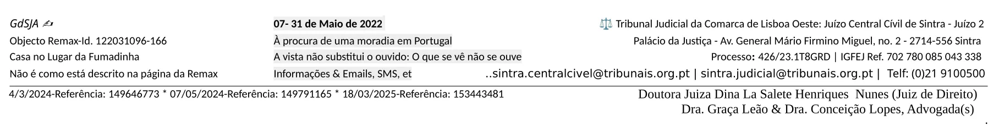

### Thema:  Cronologia de mais um Processo que marca a Vida par sempre

- **Lugar do Objecto da causa da Demanda:** Casa no Lugar da Fumadinha

- **Motivo da ação judicial:** Objecto não corresponde à descrição apresentada no site da Remax / Rescisão do CPCV / Reembolso do capital que transferi.

- **Autor:** Gomes de Sá, José António

- **Acusados:** Remax e Proprietários

---

Remaxi-d: Objecto Remax-Id: 122031096-166 
#### Agentes Imobiliários: Abílio Sousa e  Carlos Machado
**Proprietários:** 

---

- **Advogada(s):** Dra. Graça Leão & Dra. Conceição Lopes

---

- **Comarca:** Tribunal Judicial da Comarca de Lisboa Oeste: Juízo Central Cívil de Sintra - Juízo 2

- **Comarca Adereço:** Palácio da Justiça - Av. General Mário Firmino Miguel, no. 2 - 2714-556 

- **Comarca Email:** sintra.centralcivel@tribunais.org.pt | sintra.judicial@tribunais.org.pt | 

- **Comarca Fax & Telf:** (0)21 9100500

- **Processo nº :** 426/23.1T8GRD 

>IGFEJ Ref. 702 780 085 043 338
 

