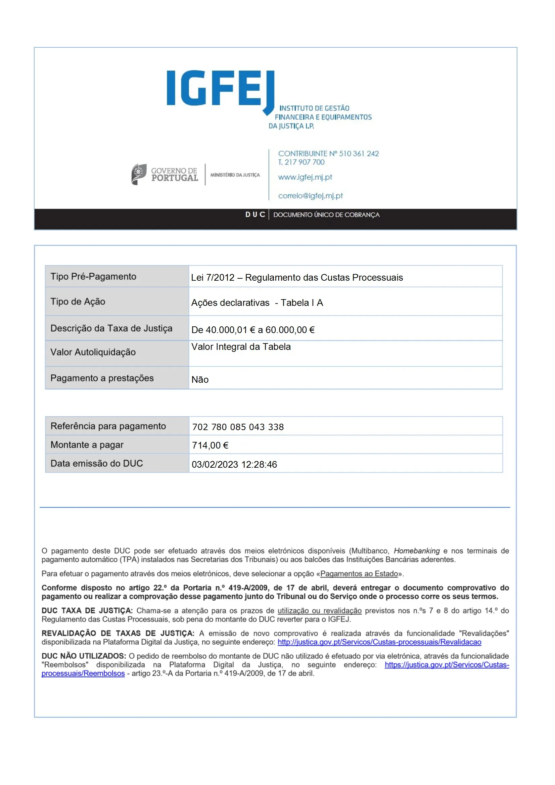

### 🇵🇹 Fatura sem avaliação jurídica

### 🇩🇪 Rechnung ohne Rechtsberatung

### 🇬🇧 Invoice without legal advice

### 🇪🇸 Factura sin asesoramiento jurídico

**..., ... .** 

**..., ... .** 

**..., ... .** 

---

  

🇬🇧 🇪🇸 🇵🇹 🇩🇪

---

**↪** [20220521-19h00_Fumadinha](../202205_O-Retorno/20220521-19h00_Fumadinha.md)

**↪ [20221007_Vila-Praia-de-Ancora_Nelas](20221007_Vila-Praia-de-Ancora_Nelas.md)**

**↪** [20230216_Haan_Viana-do-Castelo_Nelas](20230216_Haan_Viana-do-Castelo_Nelas.md)

**↪**

---

🔁 [ Os Caminhos](https://github.com/GomesDeSa-JA/Camino-del-Salvador_2023-2025/blob/main/Os_Caminhos.md)

---

#### Obsidian-Link
>*Internal links that don't work on GitHub*

↪ [Readme](Jakobswege/Readme.md) 

↪ [Os Caminhos](Os_Caminhos.md)

↪ [Index](Index.md)

 ...→