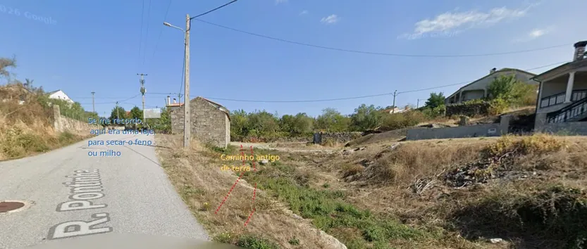

### 🇩🇪 Meine Urgroßeltern

#### Meine Urgroßmutter mütterlicherseits

Ich habe beschlossen, mich mit einem der tiefsten Ursprünge meiner Existenz auseinanderzusetzen: der Familie meiner Mutter. Dabei möchte ich meiner Urgroßmutter mütterlicherseits einen besonderen Platz in unserer Familiengeschichte einräumen.

**Ihr Name wurde vom Wind der Vergessenheit davongetragen.**

Als deine Urgroßmutter starb, 

Ich erinnere mich nicht an den Namen meiner Urgroßmutter. Wenn er einmal erwähnt wurde, schien ihn der Wind der Vergessenheit davonzutragen, sobald er ausgesprochen war. Meine Erinnerung konnte ihn nicht festhalten.

Die wenigen Sätze, die über sie fielen, begannen meistens mit Worten wie:

„Als deine Urgroßmutter starb, war es deine Großmutter Graça, die kochte, die Wäsche wusch und das Haus putzte.“

„Als deine Urgroßmutter starb, musste deine Großmutter Graça sich allein um den Haushalt kümmern.“

Oder: „Als deine Urgroßmutter starb, musste deine Großmutter den Haushalt führen.“

In den wenigen Fällen, in denen von ihr gesprochen wurde, erfuhr ich nichts darüber, ob meine Urgroßmutter eine strenge und ernste oder eine fröhliche und herzliche Frau gewesen war.

Die Leere, die ihr Tod hinterließ, ließ ihren Namen aus dem Familiengedächtnis verschwinden. Die Auswirkungen ihres Todes waren jedoch noch Jahrzehnte später in der Familiengeschichte spürbar.

#### Wann wurde sie geboren?

**Eine Wahrscheinlichkeitsrechnung zur Geburt meiner Urgroßmutter**

Als Ausgangspunkt nehme ich das Geburtsjahr meiner Mutter Maria Augusta, 1945. Außerdem berücksichtige ich die damals geltenden kirchlichen und zivilrechtlichen Vorschriften sowie die Traditionen und gesellschaftlichen Erwartungen rund um die Eheschließung.

Nach den damaligen gesetzlichen Bestimmungen durften Mädchen mit Zustimmung ihrer Eltern bereits ab dem 16. Lebensjahr heiraten. Den gesellschaftlichen Erwartungen und Traditionen entsprechend wurde von ihnen häufig erwartet, möglichst früh zu heiraten.

Ich gehe davon aus, dass sowohl meine Urgroßmutter als auch meine Großmutter mit etwa 18 Jahren heirateten und, der damaligen Tradition entsprechend, ungefähr ein Jahr später Mutter wurden.

Daraus ergibt sich folgende Schätzung: Meine Großmutter wurde um 1926 geboren, meine Urgroßmutter vermutlich um 1907.

Damals begannen Mädchen im Alter von etwa 14 Jahren, einen großen Teil der Hausarbeit zu übernehmen. Als meine Urgroßmutter starb, dürfte meine Großmutter wahrscheinlich zwischen 13 und 15 Jahre alt gewesen sein.

Meine Mutter sagte immer: „Deine Großmutter musste lernen, sich um den Haushalt zu kümmern.“

Und mein Großvater erzählte mir, wenn er von den Schwierigkeiten der Familie sprach: „Als ich deine Großmutter heiratete, sollte sie die Herrin meines Hauses sein. Aber sie blieb weiterhin eher die Herrin des Hauses ihres Vaters als die meines Hauses.“

Ich vermute deshalb, dass meine Urgroßmutter zwischen 1939 und 1942 gestorben ist.

Meine Mutter hat ihre Großmutter, also meine Urgroßmutter, nie kennengelernt. Offenbar hat sie auch durch Erzählungen nichts Näheres über sie erfahren.

---

#### Mein Urgroßvater mütterlicherseits

Der Name meines Urgroßvaters war Antonio Cardoso.

Wann er geboren wurde und wie alt er geworden ist, kann ich nicht sagen. Auch aus Erzählungen oder anderen Quellen lässt sich das nicht ableiten.

Bei Eheschließungen waren die Männer damals in den meisten Fällen älter als ihre Ehefrauen. Wenn ich das geschätzte Geburtsjahr meiner Urgroßmutter als Bezugspunkt nehme, wurde mein Urgroßvater wahrscheinlich vor 1907 geboren. Er starb  Mitte der 1970er-Jahre.

Demnach dürfte er deutlich über 70 Jahre alt geworden sein.

Ich war damals etwa sieben oder acht Jahre alt. Ich erinnere mich noch daran, wie wir an seinem Haus vorbeigingen und er auf der Granitbank vor seinem Haus saß und auf die wärmende Morgensonne wartete.

Die wenigen Male, bei denen ich ihn sah, waren wir immer auf dem Weg zum „Lameiro do Fundo“. Kurz nach der Kapelle „São Matias“, an der Scheune von „Senhor Diamantino“, hielten wir am Wegesrand an und begrüßten ihn aus einiger Entfernung.

Meistens waren es einfache Gespräche, die nicht länger als fünf Minuten dauerten.

„Bom dia!“

„Então vocemecê está ao sol, com este frio faz bem.“

„Então já está melhor?“

„E como vai a sua saúde?“

„Como vai vocemecê?“

„Como está/vai a tia Tadeia?“

Auch die Begrüßungen und Antworten waren ritualisiert und wiederholten sich immer wieder:

„Venham com Deus.“

„Cá vou indo, com a minha idade não espero muito.“

„Já estou velho, já não posso fazer nada.“

„Com a ajuda de Deus cá vamos indo.“

„É como Deus quer, ele é que manda.“

Oder: „Já estou melhor, graças a Deus.“

Mit ebenso vertrauten und ritualisierten Sätzen verabschiedeten wir uns:

„Olhe, vou-me lá que já está a ficar tarde. Até logo, e fique com Deus.“

„Até logo, boas melhoras e Deus o ajude.“

„A vocês também, ide com Deus.“

Ich kann mich nicht daran erinnern, dass wir auf dem Rückweg vom „Lameiro do Fundo“ angehalten hätten, um meinen Urgroßvater zu begrüßen. Wir trafen ihn entweder in den frühen Morgenstunden oder am späten Nachmittag, wenn wir Gras für die Tiere holten. Zurück nach Hause gingen wir gewöhnlich gegen Mittag oder bei Sonnenuntergang.

**Vermerk:** „Lameiro“ bezeichnet sowohl eine Wiese als auch eines der vielen landwirtschaftlich genutzten Gebiete meines Dorfes.

Auf dem Hinweg, auf der Wiese und auf dem Rückweg begegneten wir auch anderen Dorfbewohnern. Mit ihnen dauerten die Gespräche manchmal länger als fünf Minuten.

Die Begrüßungen und Antworten bestanden aus denselben ritualisierten Sätzen, die ich bereits beschrieben habe. Außerdem sprach man über das Wetter. Dabei ging es meistens um dessen Auswirkungen auf die Landwirtschaft und die daraus entstehenden Folgen.

Ich möchte hier nur einige der Sätze festhalten, die ich unzählige Male gehört habe:

„Sempre veio Sol, graças a Deus, bem estávamos a precisar dele para fazer as sementeiras.“

„Era bom que parasse de chover, tenho o milho para sachar e não posso.“

„Esta chuva fez bem, mas agora já devia parar. Tenho batatas e feijões ali que já estão a ficar cheios de ervas e, depois, já não consigo entrar lá.“

**Vermerk:** Das Wort „daninhas“ wurde im alltäglichen Sprachgebrauch so gut wie nie verwendet. Mit diesem Satz war gemeint, dass das Unkraut "ervas" die Kulturpflanzen inzwischen so stark überwuchert wurde, dass man die Situation kaum noch unter Kontrolle bringen konnte. Ein weiterer Versuch, das Unkraut zu entfernen, konnte den Pflanzen sogar zusätzlichen Schaden zufügen.

„Está um calor e nós a precisar de uma chuva para regar os frutos.“

„Sempre choveu, bem haja Deus, esta chuva já aliviou o fruto, mas podia ter chovido um pouquinho mais porque as nascentes também já estão a secar.“

„Olha, se não fosse esta chuva, eu este ano não tinha batatas para comer.“

In diesen Gesprächen ging es auch um bereits erledigte oder noch anstehende landwirtschaftliche  Arbeiten. Man erkundigte sich nach dem Gesundheitszustand der Familienmitglieder oder sprach über andere Probleme der Dorfbewohner.

Auch mein Urgroßvater und seine neue Ehefrau, „Tia Tadeia“, sowie deren Tochter waren gelegentlich Gegenstand solcher Dorfgespräche.

Die Tochter, die Halbschwester meiner Großmutter, hatte studiert und lebte in Lissabon oder Coimbra. Wenn sie ihre Eltern besuchte, reichte die Zeit offenbar nicht aus, um sich mit den Dorfbewohnern zu unterhalten.

Sie war etwas jünger als meine Mutter. Ihren Namen kenne ich nicht. In den wenigen Sätzen, die über die neue Familie meines Urgroßvaters fielen, wurde sie nur am Rande erwähnt.

Die Fragen und Bemerkungen über meinen Urgroßvater und seine neue Familie waren fast immer dieselben. Sie lauteten beispielsweise:

„Então, como está o teu avô?“

„Ele está bem, mas já tem idade.“

„Ouvi dizer que a filha está cá.“

„Sim, eu sei, mas não a vi.“

„A tia Tadeia e ela é que estão bem. Ele vendeu tudo e já não precisam de trabalhar para o pão de cada dia.“

Aus diesen Erinnerungen an die Mitte der 1970er-Jahre und einigen Ereignissen aus der Mitte der 1980er-Jahre werde ich versuchen, die Ereignisse zwischen dem Tod meiner Urgroßmutter und dem Jahr 1960 anhand von Vermutungen zu rekonstruieren.

In diesen gut zwei Jahrzehnten ist vieles geschehen.

1. Meine Urgroßmutter ist gestorben.
    
2. Meine Großmutter Graça hat den Haushalt meines Urgroßvaters Antonio Cardoso übernommen.
    
3. Meine Großmutter Graça de Jesus Cardoso hat meinen Großvater José Gomes geheiratet, vermutlich 1943 oder 1944.
    
4. Mein Großonkel Mário hat Tia Natália geheiratet.
    
5. Am Weihnachtsabend 1945 wurde meine Mutter Maria Augusta geboren. Unmittelbar davor oder danach kam auch Tia Elena zur Welt, die Tochter meines Großonkels Mário und meiner Großtante Natália. Meine Mutter und ihre Cousine Tia Elena sind also nahezu gleich alt.
    
    **Eine Randnotiz:** Im Jahr 2006 unternahm ich gemeinsam mit Tante Elena eine Fußwallfahrt nach Fátima.
    
6. Mein Großvater mütterlicherseits arbeitete, soweit ich weiß, zwischen Mitte der 1940er-Jahre und Anfang der 1950er-Jahre an der Modernisierung der Wasserversorgung in Lissabon.
    
7. Mein Urgroßvater Antonio Cardoso heiratete nach dieser Zeit, vermutlich zwischen 1950 und 1960, ein zweites Mal.
    
8. Die Halbschwester meiner Großmutter Graça wurde in dieser Zeit geboren.
    
9. Mein Großvater und die vier Brüder meiner Großmutter – Mário, Manuel"?", Davide und Armando – wanderten in den 1950er-Jahren, vermutlich zwischen 1951 und 1955, nach Brasilien aus.

Zwischen dem ersten und dem neunten Punkt ist noch vieles geschehen. Einen Teil davon kann ich anhand von Erzählungen, Bemerkungen und eigenen Erinnerungen rekonstruieren. Andere Ereignisse bleiben Vermutungen.

Eine meiner Vermutungen ist, dass nach dem Tod meiner Urgroßmutter die Erbteilung erfolgte. Da die Ländereien im Dorf nicht ausreichten, um den Lebensunterhalt mehrerer Generationen zu sichern, verkauften mein Großvater sowie meine Großonkel Mário, Davide, Manuel und Armando de Jesus Cardoso ihre jeweiligen Erbanteile. Sie waren die Brüder meiner Großmutter Graça de Jesus Cardoso und somit die Schwäger meines Großvaters José Gomes.

Mit dem Erlös wollten sie einen Teil der Reisekosten und der übrigen Ausgaben im Zusammenhang mit ihrer Auswanderung nach Brasilien finanzieren.

---

📌 Anmerkung 

### Anmerkung

Ich weiß, dass es in Carril ein Grundstück gab, das nicht verkauft wurde. Ein Teil dieses geerbten Grundstücks wurde in den 1980er-Jahren von meinem Großvater erworben. Den anderen Teil kauften "Tio Agostinho", der Ehemann von "Tia Elena", von meinen Großonkeln, die damals in Brasilien lebten.

Eine weitere Besonderheit betrifft die Mühle an der Brücke. Auch sie wurde nicht aufgeteilt, sondern blieb gemeinsames Erbe meines Urgroßvaters Antonio Cardoso und meines Großonkels Manuel Cardoso. Erst in den 1980er-Jahren wurde auch dieses Erbe endgültig geregelt.

Für meine Ururgroßeltern oder Urgroßeltern muss diese Mühle damals einen unschätzbaren Wert gehabt haben. Niemand wollte sich von ihr trennen. Ich erinnere mich noch daran, wie mein Großonkel Manuel Cardoso die Mühle bis Ende der 1970er-Jahre betrieb.

An einen besonderen Moment aus dieser Zeit erinnere ich mich bis heute sehr lebendig: Eines Tages nahm er mich auf seinem Pferd mit. Ich war damals etwa vier oder fünf Jahre alt. Als wir bei seinem Haus ankamen und er mich vom Pferd hob, stand ich plötzlich neben diesem riesigen Tier. Dieser überwältigende Eindruck hat sich tief in mein Gedächtnis eingeprägt und ist mir bis heute geblieben.

Im Laufe der Zeit haben verschiedene Entwicklungen dazu beigetragen, dass viele dieser Mühlen ihre ursprüngliche Bedeutung verloren haben. Durch den Klimawandel steht mancherorts immer weniger Wasser zur Verfügung, um die Mühlräder anzutreiben und die Mühlsteine in Bewegung zu setzen. Gleichzeitig haben Modernisierung und Mechanisierung die traditionellen Mühlen weitgehend überflüssig gemacht. Abgesehen von ihrem nostalgischen und historischen Wert besitzen sie heute kaum noch den Stellenwert, den sie einst hatten, als sie das Getreide für das tägliche Brot mahlten.

Ein weiterer Grund für den Verfall oder die Aufgabe vieler Mühlen war die Abwanderung der Menschen aus den Dörfern in die Städte oder ins Ausland. Auf den kleinen landwirtschaftlichen Parzellen wird heute vielfach kein Mais oder Roggen mehr angebaut. Wo früher Getreide für den eigenen Bedarf geerntet wurde, fehlt inzwischen auch die Grundlage für den Betrieb der Mühlen.

[Os-Moinhos](../Outros-Temas/Os-Moinhos.md)

---

Das Geld aus dem Verkauf der Grundstücke reichte jedoch nicht aus. Deshalb musste mein Großvater sich zusätzlich Geld bei „Senhor Antoninho Requinta“ leihen.

**Anmerkung:** Einen Teil dieser Schulden musste später noch meine Mutter begleichen, die damals als Tagelöhnerin arbeitete.

Ende der 1960er-Jahre unterstützte mein Großvater sie seinerseits finanziell, als wir geboren wurden. Er schickte ihr aus Brasilien 1.000 Escudos, damit sie die Medikamente und das Milchpulver für uns in der Apotheke von Dr. Fausto Xavier in Lamas bezahlen konnte.

**Damals** war es üblich, Medikamente in der Apotheke auf Kredit zu bekommen und die Rechnung zu begleichen, sobald man dazu finanziell in der Lage war.
Auf diese Weise beglich mein Großvater später einen Teil der Schulden.

Mein Urgroßvater António Cardoso fühlte sich vermutlich einsam und heiratete deshalb ein zweites Mal. Er verkaufte seinen gesamten verbliebenen Besitz, also die Hälfte plus einen der sechs Erbanteile von der andere Hälfte. Mit dem Geld finanzierte er die Ausbildung seiner Tochter aus zweiter Ehe in Coimbra oder Lissabon – ich weiß nicht mehr genau, wo sie studierte. Anschließend führte er bis zu seinem Lebensende ein ruhiges Leben.

Obwohl in diesen beiden Jahrzehnten unglaublich viel geschehen war, wurde über all diese Ereignisse kaum gesprochen. Meine Großmutter und meine Tante waren 1964 gemeinsam mit meinem Großvater nach Brasilien ausgewandert. Die Familie war nun weit verstreut.

Wenn von den Angehörigen im fernen Brasilien die Rede war, umgab diese Entfernung noch immer eine besondere Aura. Die alten Probleme schienen zurückgelassen worden zu sein, obwohl sie in gewisser Weise unser zukünftiges Verhalten und unser Leben weiterhin beeinflussten.

Ich halte diese Art des Umgangs mit der Vergangenheit nicht für gut. Denn wenn über schwierige Ereignisse geschwiegen wird, lernen die Menschen nicht, mit ähnlichen Situationen in der Zukunft umzugehen. Stattdessen herrscht Schweigen, und man hofft, dass die Zeit alles regeln wird.

Aufteilung des Nachlasses
- Hinterbliebener Ehepartner: 7/12 = 58,33 %
- Insgesamt fünf Kinder: 5/12 = 41,67 %
- Jedes Kind erhält: 1/12 = 8,33 %

---

### 🇵🇹 Os meus bisavós

#### A minha bisavó materna, 

Decidi dedicar-me a um dos aspetos mais profundos das minhas origens: a família da minha mãe. Quero, em particular, dar à minha bisavó materna um lugar especial na história da nossa família.

**O seu nome foi levado pelo vento do esquecimento.**

Quando a tua bisavó morreu

Não me lembro do nome da minha bisavó. Quando, por vezes, o seu nome era mencionado, parecia que o vento do esquecimento o levava assim que era pronunciado. A minha memória nunca conseguiu retê-lo.

As poucas frases que se diziam sobre ela começavam quase sempre com palavras como estas:

«Quando a tua bisavó morreu, foi a tua avó Graça que passou a cozinhar, a lavar a roupa e a limpar a casa.»

«Quando a tua bisavó morreu, a tua avó Graça teve de assumir sozinha todas as tarefas domésticas.»

Ou: «Quando a tua bisavó morreu, a tua avó teve de tomar conta da casa.»

Nas poucas ocasiões em que se falava dela, nunca soube se a minha bisavó era uma mulher severa e séria ou alegre e afetuosa.

O vazio que a sua morte deixou fez desaparecer o seu nome da memória da família. No entanto, as consequências dessa morte continuaram a fazer-se sentir na história familiar durante décadas.

#### Quando nasceu?

**Um cálculo de probabilidades sobre o nascimento da minha bisavó**

Como ponto de referência, vou utilizar o ano de nascimento da minha mãe, Maria Augusta, 1945. Terei também em consideração as disposições legais e religiosas em vigor naquela época, bem como os costumes e as expectativas sociais relacionados com o casamento.

Segundo a legislação da época, as raparigas podiam casar a partir dos 16 anos, desde que tivessem autorização dos pais. De acordo com as expectativas e tradições sociais, esperava-se frequentemente que casassem o mais cedo possível.

Parto do princípio de que tanto a minha bisavó como a minha avó se casaram por volta dos 18 anos e, como era tradição na época, foram mães aproximadamente um ano depois.

Assim, a minha avó terá nascido por volta de 1926 e a minha bisavó, provavelmente, por volta de 1907.

Naquela época, as raparigas começavam, por volta dos 14 anos, a assumir uma parte significativa das tarefas domésticas. Quando a minha bisavó morreu, a minha avó teria provavelmente entre 13 e 15 anos.

A minha mãe dizia sempre: «A tua avó teve de aprender a tratar da casa.»

E o meu avô, quando me contava as dificuldades por que a família tinha passado, dizia-me: «Quando me casei com a tua avó, ela devia ser a senhora da minha casa. Mas continuou a ser mais a senhora da casa do pai dela do que da minha.»

Por isso, suponho que a minha bisavó tenha falecido entre 1939 e 1942.

A minha mãe nunca chegou a conhecer a avó dela, ou seja, a minha bisavó. Pelo que parece, também nunca ficou a saber nada de concreto sobre ela através de relatos de outras pessoas.

---

### O meu bisavô materno

O nome do meu bisavô era Antonio Cardoso.

Não sei quando nasceu nem que idade tinha quando morreu. Também não consigo deduzir essas informações a partir de relatos ou de outras fontes.

Naquela época, na maioria dos casamentos, os homens eram mais velhos do que as mulheres. Tomando como referência o ano de nascimento estimado da minha bisavó, o meu bisavô terá nascido antes de 1907. Ele faleceu em meados da década de 1970.

Por conseguinte, deverá ter vivido bem mais de 70 anos.

Eu tinha então cerca de sete ou oito anos. Ainda me lembro de passarmos em frente à casa dele e de o vermos sentado no banco de granito diante da casa, à espera dos primeiros raios de sol da manhã para se aquecer.

Nas poucas ocasiões em que o vi, estávamos sempre a caminho do «Lameiro do Fundo». Pouco depois da capela de «São Matias», junto ao palheiro do «Senhor Diamantino», parávamos à beira do caminho e cumprimentávamo-lo à distância.

Na maioria das vezes, eram conversas simples, que não duravam mais de cinco minutos.

«Bom dia!»

«Então vocemecê está ao sol, com este frio faz bem.»

«Então já está melhor?»

«E como vai a sua saúde?»

«Como vai vocemecê?»

«Como está/vai a tia Tadeia?»

Também as saudações e as respostas eram ritualizadas e repetiam-se constantemente:

«Venham com Deus.»

«Cá vou indo, com a minha idade não espero muito.»

«Já estou velho, já não posso fazer nada.»

«Com a ajuda de Deus cá vamos indo.»

«É como Deus quer, ele é que manda.»

Ou: «Já estou melhor, graças a Deus.»

Despedíamo-nos com frases igualmente familiares e ritualizadas:

«Olhe, vou-me lá que já está a ficar tarde. Até logo, e fique com Deus.»

«Até logo, boas melhoras e Deus o ajude.»

«A vocês também, ide com Deus.»

Não me lembro de alguma vez termos parado no caminho de regresso do «Lameiro do Fundo» para cumprimentar o meu bisavô. Encontrávamo-lo de manhã cedo ou ao fim da tarde, quando íamos buscar erva para os animais. Regressávamos normalmente a casa por volta do meio-dia ou ao pôr do sol.

**Nota:** «Lameiro» é simultaneamente o nome de um prado e de uma das muitas zonas agrícolas da minha aldeia.

No caminho de ida, no prado e no regresso, encontrávamos também outros habitantes da aldeia. Com eles, as conversas por vezes duravam mais de cinco minutos.

As saudações e as respostas eram compostas pelas mesmas frases ritualizadas que já referi. Falava-se também do tempo, sobretudo dos seus efeitos na agricultura e das consequências que daí resultavam.

Quero registar apenas algumas das frases que ouvi milhares de vezes:

«Sempre veio Sol, graças a Deus, bem estávamos a precisar dele para fazer as sementeiras.»

«Era bom que parasse de chover, tenho o milho para sachar e não posso.»

«Esta chuva fez bem, mas agora já devia parar. Tenho batatas e feijões ali que já estão a ficar cheios de ervas e, depois, já não consigo entrar lá.»

**Nota:** A palavra «daninhas» quase nunca era utilizada na linguagem quotidiana. O que esta frase queria dizer era que as ervas tinham crescido tanto que estavam a sufocar as culturas. A situação já estava praticamente fora de controlo e, ao tentar eliminar as ervas, corria-se até o risco de danificar as próprias plantas.

«Está um calor e nós a precisar de uma chuva para regar os frutos.»

«Sempre choveu, bem haja Deus, esta chuva já aliviou o fruto, mas podia ter chovido um pouquinho mais porque as nascentes também já estão a secar.»

«Olha, se não fosse esta chuva, eu este ano não tinha batatas para comer.»

Nestas conversas falava-se também dos trabalhos agrícolas já realizados ou daqueles que ainda estavam por fazer. Perguntava-se pela saúde dos familiares ou conversava-se sobre outros problemas dos habitantes da aldeia.

O meu bisavô, a sua nova esposa, «Tia Tadeia», e a filha de ambos também eram, por vezes, assunto das conversas da aldeia.

A filha, meia-irmã da minha avó, tinha estudado e vivia em Lisboa ou Coimbra. Quando visitava os pais, aparentemente não havia tempo suficiente para conversar com os habitantes da aldeia.

Era um pouco mais nova do que a minha mãe. Não sei qual era o seu nome. Nas poucas frases que se diziam sobre a nova família do meu bisavô, ela era apenas mencionada de passagem.

As perguntas e os comentários sobre o meu bisavô e a sua nova família eram quase sempre os mesmos. Por exemplo:

«Então, como está o teu avô?»

«Ele está bem, mas já tem idade.»

«Ouvi dizer que a filha está cá.»

«Sim, eu sei, mas não a vi.»

«A tia Tadeia e ela é que estão bem. Ele vendeu tudo e já não precisam de trabalhar para o pão de cada dia.»

A partir destas recordações de meados da década de 1970 e de alguns acontecimentos de meados da década de 1980, vou tentar reconstruir, com base em suposições, os acontecimentos ocorridos entre a morte da minha bisavó e o ano de 1960.

Ao longo dessas duas décadas, aconteceu muita coisa.

1. A minha bisavó morreu.
    
2. A minha avó Graça assumiu as tarefas domésticas e a gestão da casa do meu bisavô Antonio.
    
3. A minha avó Graça casou com o meu avô José, provavelmente em 1943 ou 1944.
    
4. O meu tio-avô Mário casou com a Tia Natália.
    
5. Na noite de Natal de 1945 nasceu a minha mãe, Maria Augusta. Pouco antes ou pouco depois nasceu também a Tia Elena, filha do meu tio-avô Mário e da minha tia-avó Natália. A minha mãe e a sua prima Tia Elena têm, portanto, praticamente a mesma idade.
    
    **Uma nota à margem:** Em 2006, fiz uma peregrinação a pé até Fátima juntamente com a Tia Elena.
    
6. O meu avô materno trabalhou, tanto quanto sei, entre meados da década de 1940 e o início da década de 1950 na modernização do abastecimento de água em Lisboa.
    
7. Depois desse período, provavelmente entre 1950 e 1960, o meu bisavô Antonio Cardoso voltou a casar.
    
8. A meia-irmã da minha avó Graça nasceu durante esse período.
    
9. O meu avô e os quatro irmãos da minha avó — Mário, Manuel, Davide e Armando — emigraram para o Brasil na década de 1950, provavelmente entre 1951 e 1955.
    

Entre o primeiro e o nono ponto aconteceram ainda muitas outras coisas. Uma parte delas consigo reconstruir através de relatos, comentários e das minhas próprias recordações. Outros acontecimentos continuam a ser apenas suposições.

Uma das minhas hipóteses é que, após a morte da minha bisavó, tenha ocorrido a partilha da herança. Como as terras da aldeia não eram suficientes para garantir o sustento de várias gerações, o meu avô e os meus tios-avôs Mário, Davide, Manuel e Armando de Jesus Cardoso venderam as respetivas partes da herança. Eram irmãos da minha avó Graça de Jesus Cardoso e, por conseguinte, cunhados do meu avô José Gomes.

📌 Nota 

### Nota

Sei que existia em Carril um terreno que não foi vendido. Uma parte desse terreno herdado foi adquirida pelo meu avô na década de 1980. A outra parte foi comprada aos meus tios-avós, que na altura viviam no Brasil, pelo "Tio Agostinho", marido da  "Tia Elena".

Outra particularidade diz respeito ao moinho junto à ponte. Também ele não foi dividido, tendo permanecido como herança comum do meu bisavô Antonio Cardoso e do meu tio-avô Manuel Cardoso. Só na década de 1980 é que esta herança foi definitivamente regularizada.

Naquela época, este moinho devia ter um valor incalculável para os meus trisavós ou bisavós. Ninguém queria separar-se dele. Ainda me lembro de como o meu tio-avô Manuel Cardoso continuou com  o moinho até ao final da década de 1970.

Guardo até hoje uma recordação muito viva de um momento especial dessa época: um dia, levou-me consigo no seu cavalo. Eu tinha então cerca de quatro ou cinco anos. Quando chegámos a casa dele e me ajudou a descer do cavalo, fiquei de repente ao lado daquele animal enorme. A impressão que aquele momento me causou foi tão forte que ainda hoje permanece bem viva na minha memória.

Ao longo do tempo, vários fatores contribuíram para que muitos destes moinhos perdessem a sua importância original. Devido às alterações climáticas, há cada vez menos água disponível em alguns locais para fazer mover as rodas dos moinhos e pôr as mós em funcionamento. Ao mesmo tempo, a modernização e a mecanização tornaram os moinhos tradicionais praticamente desnecessários. Para além do seu valor nostálgico e histórico, já não têm a importância que outrora tiveram, quando moíam os cereais destinados ao pão de todos os dias.

Outro motivo para a degradação ou o abandono de muitos moinhos foi o êxodo das populações das aldeias para as cidades ou para o estrangeiro. Nas pequenas parcelas agrícolas, já quase ninguém cultiva milho ou centeio. Onde antigamente se produziam cereais para consumo próprio, deixou também de existir a matéria-prima que justificava o funcionamento dos moinhos.

[Os Moinhos](../Outros-Temas/Os-Moinhos.md)

---

Com o dinheiro da venda pretendiam financiar uma parte das despesas da viagem e dos outros custos relacionados com a emigração para o Brasil.

No entanto, o dinheiro obtido com a venda das propriedades não foi suficiente. Por isso, o meu avô teve de pedir dinheiro emprestado ao «Senhor Antoninho Requinta».

**Nota:** Uma parte dessas dívidas ainda teve de ser paga pela minha mãe, que trabalhava à jorna.

Mais tarde, no final da década de 1960, quando nós nascemos, foi o meu avô quem a ajudou financeiramente. Enviou-lhe do Brasil 1.000 escudos para que pudesse pagar os medicamentos e o leite em pó de que precisávamos na farmácia do Dr. Lausto Xavier, em Lamas.

Naquela época, era habitual as pessoas levantarem os medicamentos a crédito na farmácia e pagarem a conta quando tivessem condições financeiras para o fazer.

Dessa forma, o meu avô acabou por liquidar uma parte das dívidas.

O meu bisavô António Cardoso sentia-se provavelmente sozinho e, por isso, voltou a casar. Vendeu todos os bens que ainda possuía, ou seja, metade mais uma das seis partes da herança da outra metade. Com esse dinheiro financiou os estudos da filha do segundo casamento em Coimbra ou Lisboa — já não me lembro exatamente onde ela estudou. Depois disso, levou uma vida tranquila até ao fim dos seus dias.

Apesar de terem acontecido tantas coisas extraordinárias ao longo dessas duas décadas, quase nunca se falava de todos esses acontecimentos. Em 1964, a minha avó e a minha tia tinham emigrado para o Brasil juntamente com o meu avô. A família ficou dispersa por diferentes lugares.

Quando se falava dos familiares que viviam no longínquo Brasil, essa distância continuava a envolvê-los numa espécie de aura especial. Os problemas antigos pareciam ter ficado para trás, embora, de certa forma, continuassem a influenciar o nosso comportamento futuro e as nossas vidas.

Não considero esta forma de lidar com o passado saudável. Quando se guarda silêncio sobre acontecimentos difíceis, as pessoas não aprendem a enfrentar situações semelhantes no futuro. Em vez disso, instala-se o silêncio e espera-se que o tempo resolva tudo.

Repartição da herança
- Cônjuge sobrevivo 7/12 = 58,33 %
- Cinco filhos no total  5/12 = 41,67 %
- Cada filho recebe: 1/12 = 8,33 %

---

### 🇪🇸 Mis bisabuelos

#### Mi bisabuela materna

He decidido dedicarme a uno de los aspectos más profundos de mis orígenes: la familia de mi madre. En particular, quiero reservar un lugar especial en nuestra historia familiar para mi bisabuela materna.

**Su nombre se lo llevó el viento del olvido.**

Cuando murió tu bisabuela, 

No recuerdo el nombre de mi bisabuela. Cuando alguna vez se mencionaba, parecía que el viento del olvido se lo llevaba en cuanto era pronunciado. Mi memoria nunca consiguió retenerlo.

Las pocas frases que se decían sobre ella comenzaban casi siempre con palabras como estas:

«Cuando murió tu bisabuela, fue tu abuela Graça quien empezó a cocinar, lavar la ropa y limpiar la casa».

«Cuando murió tu bisabuela, tu abuela Graça tuvo que hacerse cargo sola de todas las tareas domésticas».

O bien: «Cuando murió tu bisabuela, tu abuela tuvo que encargarse de la casa».

En las pocas ocasiones en que se hablaba de ella, nunca llegué a saber si mi bisabuela era una mujer estricta y seria o alegre y cariñosa.

El vacío que dejó su muerte hizo que su nombre desapareciera de la memoria familiar. Sin embargo, las consecuencias de aquella muerte siguieron haciéndose sentir en la historia de la familia durante décadas.

#### ¿Cuándo nació?

**Un cálculo de probabilidades sobre el nacimiento de mi bisabuela**

Como punto de partida, tomaré el año de nacimiento de mi madre, Maria Augusta, 1945. También tendré en cuenta las disposiciones legales y religiosas vigentes en aquella época, así como las costumbres y expectativas sociales relacionadas con el matrimonio.

Según la legislación de entonces, las muchachas podían casarse a partir de los 16 años con el consentimiento de sus padres. De acuerdo con las expectativas y tradiciones sociales, se esperaba de ellas que se casaran lo antes posible.

Parto de la hipótesis de que tanto mi bisabuela como mi abuela se casaron alrededor de los 18 años y que, siguiendo la tradición de la época, fueron madres aproximadamente un año después.

De este modo, mi abuela habría nacido hacia 1926 y mi bisabuela, probablemente, hacia 1907.

En aquella época, las muchachas empezaban a asumir una parte importante de las tareas domésticas alrededor de los 14 años. Cuando murió mi bisabuela, mi abuela tendría probablemente entre 13 y 15 años.

Mi madre siempre decía: «Tu abuela tuvo que aprender a ocuparse de la casa».

Y mi abuelo, cuando me contaba las dificultades por las que había pasado la familia, me decía: «Cuando me casé con tu abuela, ella debía ser la señora de mi casa. Pero siguió siendo más la señora de la casa de su padre que de la mía».

Por eso, supongo que mi bisabuela falleció entre 1939 y 1942.

Mi madre nunca llegó a conocer a su abuela, es decir, a mi bisabuela. Por lo que parece, tampoco llegó a saber nada concreto sobre ella a través de los relatos de otras personas.

---

#### Mi bisabuelo materno

Mi bisabuelo se llamaba Antonio Cardoso.

No sé cuándo nació ni qué edad tenía cuando murió. Tampoco puedo deducirlo a partir de relatos o de otras fuentes.

En aquella época, en la mayoría de los matrimonios, los hombres eran mayores que sus esposas. Si tomo como referencia el año de nacimiento estimado de mi bisabuela, mi bisabuelo debió de nacer antes de 1907. Elle falleció a mediados de la década de 1970.

Por tanto, debió de superar ampliamente los 70 años.

Yo tenía entonces unos siete u ocho años. Todavía recuerdo que pasábamos por delante de su casa y lo veíamos sentado en el banco de granito que había frente a ella, esperando los primeros rayos del sol de la mañana para calentarse.

Las pocas veces que lo vi, siempre estábamos de camino al «Lameiro do Fundo». Poco después de la capilla de «São Matias», junto al cobertizo de «Senhor Diamantino», nos deteníamos al borde del camino y lo saludábamos desde cierta distancia.

  

La mayoría de las veces eran conversaciones sencillas que no duraban más de cinco minutos.

«Bom dia!»

«Então vocemecê está ao sol, com este frio faz bem.»

«Então já está melhor?»

«E como vai a sua saúde?»

«Como vai vocemecê?»

«Como está/vai a tia Tadeia?»

Los saludos y las respuestas también estaban ritualizados y se repetían una y otra vez:

«Venham com Deus.»

«Cá vou indo, com a minha idade não espero muito.»

«Já estou velho, já não posso fazer nada.»

«Com a ajuda de Deus cá vamos indo.»

«É como Deus quer, ele é que manda.»

O bien: «Já estou melhor, graças a Deus.»

Nos despedíamos con frases igualmente conocidas y ritualizadas:

«Olhe, vou-me lá que já está a ficar tarde. Até logo, e fique com Deus.»

«Até logo, boas melhoras e Deus o ajude.»

«A vocês também, ide com Deus.»

No recuerdo que alguna vez nos detuviéramos en el camino de regreso del «Lameiro do Fundo» para saludar a mi bisabuelo. Nos encontrábamos con él a primera hora de la mañana o al final de la tarde, cuando íbamos a recoger hierba para los animales. Normalmente regresábamos a casa hacia el mediodía o al ponerse el sol.

**Nota:** «Lameiro» es tanto el nombre de una pradera como el de una de las numerosas zonas agrícolas de mi pueblo.

De camino hacia allí, en la pradera y durante el regreso, también nos encontrábamos con otros habitantes del pueblo. Con ellos, las conversaciones a veces duraban más de cinco minutos.

Los saludos y las respuestas estaban formados por las mismas frases ritualizadas que ya he mencionado. También se hablaba del tiempo, sobre todo de sus efectos en la agricultura y de las consecuencias que estos tenían.

Quiero recoger aquí solamente algunas de las frases que escuché miles de veces:

«Sempre veio Sol, graças a Deus, bem estávamos a precisar dele para fazer as sementeiras.»

«Era bom que parasse de chover, tenho o milho para sachar e não posso.»

«Esta chuva fez bem, mas agora já devia parar. Tenho batatas e feijões ali que já estão a ficar cheios de ervas e, depois, já não consigo entrar lá.»

**Nota:** La palabra «daninhas» casi nunca se utilizaba en el lenguaje cotidiano. Lo que se quería expresar con esta frase era que las malas hierbas habían crecido tanto que estaban ahogando los cultivos. La situación estaba prácticamente fuera de control y, al intentar eliminar las hierbas, incluso se corría el riesgo de dañar las propias plantas.

«Está um calor e nós a precisar de uma chuva para regar os frutos.»

«Sempre choveu, bem haja Deus, esta chuva já aliviou o fruto, mas podia ter chovido um pouquinho mais porque as nascentes também já estão a secar.»

«Olha, se não fosse esta chuva, eu este ano não tinha batatas para comer.»

En estas conversaciones también se hablaba de los trabajos que ya se habían realizado y de los que todavía estaban pendientes. Se preguntaba por la salud de los familiares o se comentaban otros problemas de los habitantes del pueblo.

Mi bisabuelo, su nueva esposa, «Tia Tadeia», y la hija de ambos también eran, de vez en cuando, tema de conversación en el pueblo.

La hija, hermanastra de mi abuela, había estudiado y vivía en Lisboa o Coimbra. Cuando visitaba a sus padres, al parecer no había tiempo suficiente para conversar con los vecinos del pueblo.

Era algo más joven que mi madre. No conozco su nombre. En las pocas frases que se decían sobre la nueva familia de mi bisabuelo, apenas se la mencionaba.

Las preguntas y los comentarios sobre mi bisabuelo y su nueva familia eran casi siempre los mismos. Por ejemplo:

«Então, como está o teu avô?»

«Ele está bem, mas já tem idade.»

«Ouvi dizer que a filha está cá.»

«Sim, eu sei, mas não a vi.»

«A tia Tadeia e ela é que estão bem. Ele vendeu tudo e já não precisam de trabalhar para o pão de cada dia.»

A partir de estos recuerdos de mediados de la década de 1970 y de algunos acontecimientos de mediados de la década de 1980, intentaré reconstruir, mediante suposiciones, los acontecimientos ocurridos entre la muerte de mi bisabuela y el año 1960.

Durante esas dos décadas sucedieron muchas cosas.

1. Mi bisabuela murió.
    
2. Mi abuela Graça se hizo cargo de las tareas domésticas y de la casa de mi bisabuelo Antonio.
    
3. Mi abuela Graça se casó con mi abuelo José, probablemente en 1943 o 1944.
    
4. Mi tío abuelo Mário se casó con Tia Natália.
    
5. La noche de Navidad de 1945 nació mi madre, Maria Augusta. Poco antes o poco después nació también Tia Elena, hija de mi tío abuelo Mário y de mi tía abuela Natália. Por tanto, mi madre y su prima Tia Elena tienen prácticamente la misma edad.
    
    **Una nota al margen:** En 2006 hice una peregrinación a pie a Fátima junto con la Tía Elena.
    
6. Mi abuelo materno trabajó, según creo, entre mediados de la década de 1940 y principios de la de 1950 en la modernización del abastecimiento de agua de Lisboa.
    
7. Después de ese período, probablemente entre 1950 y 1960, mi bisabuelo Antonio Cardoso volvió a casarse.
    
8. Durante esa época nació la hermanastra de mi abuela Graça.
    
9. Mi abuelo y los cuatro hermanos de mi abuela —Mário, Manuel, Davide y Armando— emigraron a Brasil en la década de 1950, probablemente entre 1951 y 1955.
    

Entre el primer y el noveno punto sucedieron muchas otras cosas. Una parte puedo reconstruirla a partir de relatos, comentarios y mis propios recuerdos. Otros acontecimientos siguen siendo simples suposiciones.

Una de mis hipótesis es que, tras la muerte de mi bisabuela, se procedió al reparto de la herencia. Como las tierras del pueblo no eran suficientes para garantizar el sustento de varias generaciones, mi abuelo y mis tíos abuelos Mário, Davide, António y Armando de Jesus Cardoso vendieron sus respectivas partes de la herencia. Eran hermanos de mi abuela Graça de Jesus Cardoso y, por tanto, cuñados de mi abuelo José Gomes.

---

📌 Nota 

### Nota

Sé que en Carril había una parcela que no se vendió. Una parte de ese terreno heredado fue adquirida por mi abuelo en la década de 1980. La otra parte fue comprada a mis tíos abuelos, que por aquel entonces vivían en Brasil, por mi tío Agostinho, marido de mi tía Elena.

Otra particularidad tiene que ver con el molino situado junto al puente. Tampoco se dividió, sino que permaneció como herencia común de mi bisabuelo Antonio Cardoso y de mi tío abuelo Manuel Cardoso. No fue hasta la década de 1980 cuando se regularizó definitivamente también esta herencia.

En aquella época, este molino debía de tener un valor incalculable para mis tatarabuelos o bisabuelos. Nadie quería desprenderse de él. Todavía recuerdo cómo mi tío abuelo Manuel Cardoso siguió trabajando en el molino hasta finales de la década de 1970.

Conservo hasta hoy un recuerdo muy vivo de un momento especial de aquella época: un día me llevó consigo a lomos de su caballo. Yo tendría entonces unos cuatro o cinco años. Cuando llegamos a su casa y me ayudó a bajar del caballo, me encontré de repente junto a aquel enorme animal. La impresión que me causó aquel momento fue tan intensa que todavía hoy permanece muy viva en mi memoria.

Con el paso del tiempo, diversos factores han contribuido a que muchos de estos molinos hayan perdido su importancia original. Debido al cambio climático, en algunos lugares cada vez hay menos agua disponible para mover las ruedas de los molinos y poner en funcionamiento las piedras de moler. Al mismo tiempo, la modernización y la mecanización han hecho que los molinos tradicionales hayan dejado de ser necesarios. Más allá de su valor nostálgico e histórico, hoy apenas tienen la relevancia que tuvieron antaño, cuando molían el grano destinado al pan de cada día.

Otra de las razones del deterioro o abandono de muchos molinos fue el éxodo de la población de los pueblos hacia las ciudades o al extranjero. En las pequeñas parcelas agrícolas ya casi nadie cultiva maíz o centeno. Allí donde antes se cosechaban cereales para el consumo familiar, también ha desaparecido la materia prima que justificaba el funcionamiento de los molinos.

[Os Moinhos](../Outros-Temas/Os-Moinhos.md)

---

Con el dinero obtenido pretendían financiar una parte de los gastos del viaje y de los demás costes relacionados con su emigración a Brasil.

Sin embargo, el dinero de la venta de las propiedades no fue suficiente. Por eso, mi abuelo tuvo que pedir dinero prestado a «Senhor Antoninho Requinta».

**Nota:** Una parte de esas deudas todavía tuvo que ser pagada por mi madre, que trabajaba como jornalera.

Más tarde, a finales de la década de 1960, cuando nosotros nacimos, fue mi abuelo quien la ayudó económicamente. Desde Brasil le envió 1.000 escudos para que pudiera pagar los medicamentos y la leche en polvo que necesitábamos en la farmacia del Dr. Lausto Xavier, en Lamas.

En aquella época era habitual que la gente retirara los medicamentos de la farmacia a crédito y pagara la cuenta cuando tuviera medios económicos para hacerlo.

De esta manera, mi abuelo terminó pagando una parte de las deudas.

Mi bisabuelo António Cardoso probablemente se sentía solo y por eso volvió a casarse. Vendió todos los bienes que todavía poseía, es decir, la mitad más una de las seis partes de la herencia. Con ese dinero financió los estudios de su hija del segundo matrimonio en Coimbra o Lisboa; ya no recuerdo exactamente dónde estudió. Después llevó una vida tranquila hasta el final de sus días.

Aunque durante aquellas dos décadas sucedieron muchísimas cosas, apenas se hablaba de todos esos acontecimientos. En 1964, mi abuela y mi tía habían emigrado a Brasil junto con mi abuelo. La familia quedó dispersa por diferentes lugares.

Cuando se hablaba de los familiares que vivían en el lejano Brasil, aquella distancia seguía rodeándolos de un aura especial. Parecía que los antiguos problemas habían quedado atrás, aunque, de alguna manera, continuaban influyendo en nuestro comportamiento futuro y en nuestras vidas.

No considero que esta forma de afrontar el pasado sea buena. Cuando se guarda silencio sobre los acontecimientos difíciles, las personas no aprenden a enfrentarse a situaciones similares en el futuro. En lugar de ello, se instala el silencio y se espera que el tiempo lo resuelva todo.

Reparto de la herencia
- Cónyuge supérstite: 7/12 = 58,33 %
- Cinco hijos en total: 5/12 = 41,67 %
- Cada hijo recibe: 1/12 = 8,33 %

---

### 🇬🇧 My Great-Grandparents

#### My Maternal Great-Grandmother

I have decided to explore one of the deepest roots of my existence: my mother's family. In particular, I want to give my maternal great-grandmother a special place in our family history.

**Her name was carried away by the wind of oblivion.**

When your great-grandmother died, 

I cannot remember my great-grandmother's name. Whenever it was mentioned, it seemed to be carried away by the wind of oblivion as soon as it was spoken. My memory never managed to hold on to it.

The few sentences spoken about her usually began with words such as:

"When your great-grandmother died, it was your grandmother Graça who started cooking, doing the laundry and cleaning the house."

"When your great-grandmother died, your grandmother Graça had to take care of the entire household on her own."

Or: "When your great-grandmother died, your grandmother had to take charge of the household."

On the rare occasions when she was mentioned, I never learned whether my great-grandmother had been a strict and serious woman or a cheerful and affectionate one.

The emptiness left by her death caused her name to disappear from the family's collective memory. Yet the consequences of her death continued to be felt in our family history for decades.

#### When Was She Born?

**Estimating the Probable Year of My Great-Grandmother's Birth**

As my starting point, I will use the year of my mother's birth, 1945. I will also take into account the legal and religious regulations in force at the time, as well as the customs and social expectations surrounding marriage.

Under the legislation of that period, girls could marry from the age of 16 with their parents' consent. In accordance with social expectations and traditions, they were often expected to marry as early as possible.

I assume that both my great-grandmother and my grandmother married at around 18 and, following the customs of the time, became mothers approximately one year later.

This would mean that my grandmother was born around 1926 and my great-grandmother probably around 1907.

At that time, girls began taking on a considerable share of the household chores at around the age of 14. When my great-grandmother died, my grandmother was probably between 13 and 15 years old.

My mother always used to say: "Your grandmother had to learn how to look after the household."

And when my grandfather told me about the difficulties the family had faced, he would say: "When I married your grandmother, she was supposed to be the mistress of my house. But she remained more the mistress of her father's house than of mine."

For these reasons, I suspect that my great-grandmother died sometime between 1939 and 1942.

My mother never got to know her grandmother, my great-grandmother. Apparently, she never learned anything substantial about her through other people's stories either.

---

#### My Maternal Great-Grandfather

My great-grandfather's name was Antonio Cardoso.

I do not know when he was born or how old he was when he died. Nor can I establish these details from family stories or other sources.

At that time, men were generally older than their wives when they married. Taking my great-grandmother's estimated year of birth as a reference, my great-grandfather was probably born before 1907. I assume that he died in the mid-1970s.

He must therefore have lived well beyond the age of 70.

I was about seven or eight years old at the time. I still remember walking past his house and seeing him sitting on the granite bench in front of it, waiting for the warm morning sunshine.

On the few occasions when I saw him, we were always on our way to the "Lameiro do Fundo". Shortly after passing the chapel of "São Matias", near "Senhor Diamantino's" barn, we would stop by the roadside and greet him from a distance.

Most of the time, these were simple conversations that lasted no longer than five minutes.

"Bom dia!"

"Então vocemecê está ao sol, com este frio faz bem."

"Então já está melhor?"

"E como vai a sua saúde?"

"Como vai vocemecê?"

"Como está/vai a tia Tadeia?"

The greetings and replies were equally ritualised and repeated themselves time and again:

"Venham com Deus."

"Cá vou indo, com a minha idade não espero muito."

"Já estou velho, já não posso fazer nada."

"Com a ajuda de Deus cá vamos indo."

"É como Deus quer, ele é que manda."

Or: "Já estou melhor, graças a Deus."

We said goodbye using equally familiar and ritualised expressions:

"Olhe, vou-me lá que já está a ficar tarde. Até logo, e fique com Deus."

"Até logo, boas melhoras e Deus o ajude."

"A vocês também, ide com Deus."

I cannot remember ever stopping on our way back from the "Lameiro do Fundo" to greet my great-grandfather. We would meet him either early in the morning or late in the afternoon, when we went to collect grass for the animals. We usually returned home around midday or at sunset.

**Note:** "Lameiro" is both the name of a meadow and the name of one of the many agricultural areas in my village.

On our way there, in the meadow and on our way back, we also encountered other villagers. Conversations with them sometimes lasted longer than five minutes.

The greetings and replies consisted of the same ritualised expressions I have already described. People also talked about the weather, particularly its effects on agriculture and the consequences for their work and harvests.

I would like to record just a few of the sentences I heard thousands of times:

"Sempre veio Sol, graças a Deus, bem estávamos a precisar dele para fazer as sementeiras."

"Era bom que parasse de chover, tenho o milho para sachar e não posso."

"Esta chuva fez bem, mas agora já devia parar. Tenho batatas e feijões ali que já estão a ficar cheios de ervas e, assim, já não consigo entrar lá."

**Note:** The word "daninhas" was hardly ever used in everyday speech. What this sentence meant was that the weeds had grown so extensively that they were overwhelming the crops. The situation was almost beyond control, and even trying to remove the weeds risked damaging the plants themselves.

"Está um calor e nós a precisar de uma chuva para regar os frutos."

"Sempre choveu, bem haja Deus, esta chuva já aliviou o fruto, mas podia ter chovido um pouquinho mais porque as nascentes também já estão a secar."

"Olha, se não fosse esta chuva, eu este ano não tinha batatas para comer."

These conversations also covered work that had already been completed or still needed to be done. People asked about the health of family members or discussed other problems affecting the villagers.

My great-grandfather, his new wife, "Tia Tadeia", and their daughter were occasionally subjects of conversation in the village as well.

Their daughter, my grandmother's half-sister, had studied and lived in Lisbon or Coimbra. Whenever she visited her parents, apparently there was not enough time for her to have conversations with the villagers.

She was slightly younger than my mother, her half-niece. I do not know her name. In the few remarks made about my great-grandfather's new family, she was mentioned only briefly.

The questions and comments about my great-grandfather and his new family were almost always the same. They went something like this:

"Então, como está o teu avô?"

"Ele está bem, mas já tem idade."

"Ouvi dizer que a filha está cá."

"Sim, eu sei, mas não a vi."

"A tia Tadeia e ela é que estão bem. Ele vendeu tudo e já não precisam de trabalhar para o pão de cada dia."

Drawing on these memories from the mid-1970s and a few events from the mid-1980s, I will try to reconstruct, through a series of assumptions, the events that took place between my great-grandmother's death and the year 1960.

A great deal happened during those two decades.

1. My great-grandmother died.
    
2. My grandmother Graça took over the household responsibilities and the running of my great-grandfather Antonio's home.
    
3. My grandmother Graça married my grandfather José, probably in 1943 or 1944.
    
4. My great-uncle Mário married Tia Natália.
    
5. My mother, Maria Augusta, was born on Christmas Eve 1945. Shortly before or after her birth, Tia Elena was also born. She was the daughter of my great-uncle Mário and my great-aunt Natália. My mother and her cousin Tia Elena are therefore almost exactly the same age.
    
    **A side note:** In 2006, I undertook a pilgrimage on foot to Fátima together with Aunt Elena.
    
6. As far as I know, my maternal grandfather worked on modernising Lisbon's water supply system sometime between the mid-1940s and the early 1950s.
    
7. After this period, probably between 1950 and 1960, my great-grandfather Antonio Cardoso married for a second time.
    
8. My grandmother Graça's half-sister was born during this period.
    
9. My grandfather and my grandmother's four brothers — Mário, Manuel, Davide and Armando — emigrated to Brazil in the 1950s, probably between 1951 and 1955.
    

A great deal more happened between the first and ninth points. I can reconstruct some of it through stories, comments and my own memories. Other events remain matters of speculation.

One of my assumptions is that the inheritance was divided after my great-grandmother's death. Since the land in the village was insufficient to provide a livelihood for several generations, my grandfather and my great-uncles Mário, Davide, António and Armando de Jesus Cardoso sold their respective shares of the inheritance. They were the brothers of my grandmother Graça de Jesus Cardoso and, consequently, my grandfather José Gomes's brothers-in-law.

---

📌 Note

#### Note

I know that there was a plot of land in Carril that was never sold. One part of this inherited property was purchased by my grandfather in the 1980s. The other part was bought from my great-uncles, who were living in Brazil at the time, by "Tio Agostinho", the husband of Tia Elena.

Another special case concerns the mill by the bridge. It, too, was never divided and remained jointly inherited by my great-grandfather Antonio Cardoso and my great-uncle Manuel Cardoso. It was not until the 1980s that this inheritance was finally settled as well.

At the time, this mill must have been of immeasurable value to my great-great-grandparents or great-grandparents. Nobody wanted to part with it. I still remember my great-uncle Manuel Cardoso operating the mill until the end of the 1970s.

I still have a particularly vivid memory of one special moment from that period: one day, he took me along on his horse. I was about four or five years old. When we arrived at his house and he lifted me down from the horse, I suddenly found myself standing beside this enormous animal. The impression that moment made on me was so powerful that it has stayed with me vividly to this day.

Over time, various developments have contributed to many of these mills losing their original importance. Due to climate change, less and less water is available in some places to turn the mill wheels and set the grinding stones in motion. At the same time, modernization and mechanization have made traditional mills largely obsolete. Apart from their nostalgic and historical value, they no longer hold the significance they once had, when they ground the grain used to make people's daily bread.

Another reason for the deterioration or abandonment of many mills was the migration of people from villages to cities or abroad. Small agricultural plots are no longer widely used to grow maize or rye. Where people once harvested grain for their own consumption, the very reason for keeping the mills running has gradually disappeared.

[Os Moinhos](../Outros-Temas/Os-Moinhos.md)

---

They intended to use the proceeds to cover part of the travel expenses and other costs associated with their emigration to Brazil.

However, the money from selling the properties was not enough. My grandfather therefore had to borrow additional money from "Senhor Antoninho Requinta".

**Note:** My mother, who worked as a day labourer, still had to repay part of these debts.

Later, towards the end of the 1960s, when we were born, my grandfather was the one who provided her with financial support. He sent her 1,000 Escudos from Brazil so that she could pay for the medicines and powdered milk we needed at Dr. Lausto Xavier's pharmacy in Lamas.

At that time, it was common for people to obtain their medicines from the pharmacy on credit and settle the bill once they were financially able to do so.

In this way, my grandfather eventually repaid part of the debts.

My great-grandfather António Cardoso probably felt lonely, which is why he married for a second time. He sold all the property he still owned, namely half plus one of the six (from1/2) inheritance shares. With the money, he financed the education of his daughter from his second marriage in Coimbra or Lisbon — I can no longer remember exactly where she studied. After that, he led a quiet life until the end of his days.

Although an extraordinary amount happened during those two decades, hardly anyone ever spoke about these events. In 1964, my grandmother and my aunt had emigrated to Brazil together with my grandfather. The family was now scattered across different places.

Whenever the relatives living in faraway Brazil were mentioned, that distance still seemed to surround them with a special aura. It was as though the old problems had been left behind, even though, in one way or another, they continued to influence our future behaviour and our lives.

I do not consider this a healthy way of dealing with the past. When difficult events are kept silent, people do not learn how to deal with similar situations in the future. Instead, silence takes over, and everyone hopes that time will resolve everything.

Distribution of the Estate
- Surviving spouse: 7/12 = 58.33%
- Five children in total: 5/12 = 41.67%
- Each child receives: 1/12 = 8.33%

----
