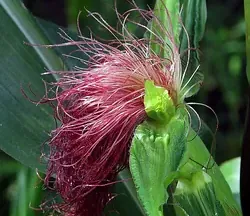
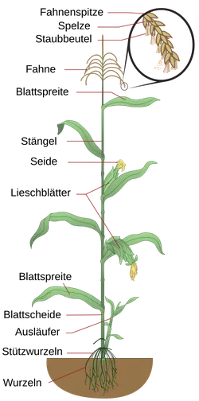

 - [Index](../Index.md)
## Experiências na vida
- Experiencias en la vida
- Life Experience
- Lebenserfahrung

### 🇵🇹 O Milho

A barba da Espiga

#### 🌽  Experiência de Vida e a Barba da Espiga

“Cada fio corresponde a um grão.” Confesso que, apesar de toda a minha juventude ligada ao campo, nunca tinha ouvido essa explicação.

E, no entanto, passei por praticamente todas as fases do cultivo do milho, desde o trabalho da terra até à cozedura do pão.

Cortei erva, lavrei e ajudei a preparar e a trabalhar a terra. Semeei, sachei, reguei e cortei as crutas do milho.

Cortei muita cana — ou simplesmente «milho», como lhe chamamos na aldeia — e participei em algumas cascadas.

Ajudei a secar o milho na laje, ensaquei-o, carreguei os sacos para o reboque do trator e, mais tarde, voltei a transportá-los para os levar às arcas.

Conforme as necessidades, retirava o milho das arcas e voltava a ensacá-lo para o levar ao moinho. Depois, ia buscar a farinha, tanto para fazer pão como para alimentar os animais. Os últimos sacos de farinha que fui buscar ao moleiro já os transportei na mala do carro.

Também ajudei a transportar tanganhos ou pernadas secas para aquecer o forno comunitário da aldeia, o nosso forno do povo, onde se cozia o pão.

Comi esse pão acompanhado de caldo verde, chouriço e presunto da casa, tal como toda a gente da aldeia.

Mas que cada fio da barba da espiga corresponde a um grão… isso, sinceramente, nunca tinha ouvido dizer na minha terra.

---

A sua experiência é particularmente interessante porque descreve praticamente todo o ciclo tradicional do milho, desde a preparação da terra até à transformação dos grãos em farinha e, finalmente, em pão.

Quanto à afirmação **«Cada fio da barba da espiga corresponde a um grão»**, posso confirmar que ela tem fundamento botânico. No entanto, há uma pequena precisão importante:

Cada fio da barba do milho (estigma) está ligado a um ovário individual da espiga, que tem potencial para se transformar num grão. Quando ocorre uma polinização bem-sucedida, esse ovário desenvolve-se num grão de milho. Por isso, a explicação popular está essencialmente correta, embora nem todos os fios resultem necessariamente num grão.

---

##### Explicação simples e rigorosa

A espiga tem centenas de óvulos (futuros grãos).  
Cada óvulo está ligado a um estigma — o fio da barba.

Quando o pendão liberta pólen:

1. O pólen cai sobre a barba.
    
2. Cada grão de pólen percorre o fio até ao óvulo.
    
3. Se chegar ao fim, forma-se um grão.
    
4. Se não chegar, o grão não se forma.
    

Por isso:

- mais barba = mais grãos potenciais
    
- barba seca = fecundação terminada
    
- falhas na espiga = fios que não receberam pólen

---

##### Confirmação científica: como funciona a barba do milho?

A explicação está cientificamente confirmada por universidades como a Pennsylvania State University e a University of Wisconsin–Madison.

O processo funciona assim:

1. Cada futuro grão de milho corresponde a um óvulo na espiga.
    
2. Cada óvulo desenvolve o seu próprio fio, que constitui o estigma e o estilete da flor feminina.
    
3. O pólen, produzido na parte superior da planta (pendão), chega a esses fios, normalmente transportado pelo vento.
    
4. O pólen germina e desenvolve um tubo polínico que percorre o fio até ao óvulo.
    
5. Quando ocorre a fecundação, o óvulo desenvolve-se e transforma-se num grão de milho.
    

Há, contudo, um pormenor interessante: uma espiga pode desenvolver cerca de 750 a 1.000 óvulos, mas nem todos chegam a transformar-se em grãos. Isso explica por que razão algumas espigas apresentam espaços vazios.

##### **Como se diz nos quatro idiomas?**

|Português|Alemão|Espanhol|Inglês|
|---|---|---|---|
|Barba da espiga|Maisbart|Barba de la mazorca|Corn silk|
|Fio|Faden|Hilo|Strand|
|Grão de milho|Maiskorn|Grano de maíz|Corn kernel|
|Espiga|Maiskolben|Mazorca|Ear of corn|
|Pendão|Maisrispe|Panoja|Tassel|

**Uma observação sobre o seu texto:** mantive algumas palavras regionais portuguesas, como _tanganhos_, _crutas_ e _cascadas_. São expressões ligadas à sua experiência e ao vocabulário da aldeia. Não quis substituí-las por palavras genéricas sem ter a certeza do seu significado local.

**A minha sugestão para o título:** _Experiência de Vida e a Barba da Espiga_ funciona muito bem. Existe nele um contraste interessante entre aquilo que aprendemos pela experiência e aquilo que só descobrimos mais tarde através da ciência.

---

#### 🌽 Porque é que quase ninguém sabia disto nas aldeias?

Porque não era preciso saber para cultivar bem o milho.

A sua surpresa é perfeitamente compreensível: conhecer todas as etapas do trabalho agrícola não significa necessariamente conhecer todos os pormenores da biologia da planta.

Mantive o caráter autobiográfico do seu texto, corrigi algumas expressões e preservei o vocabulário rural português, incluindo _sachar_, _cascadas_, _tanganhos_ e _forno do povo_.

---

### 🇩🇪  Der Mais

Der Bart der Ähre

#### 🌽 Lebenserfahrung und die Maisfäden

„Jeder Faden entspricht einem Maiskorn.“ Ich muss gestehen, dass ich diese Erklärung trotz meiner gesamten Jugend, die ich auf dem Land verbracht habe, noch nie gehört hatte.

Dabei habe ich praktisch alle Phasen des Maisanbaus miterlebt – von der Bearbeitung des Bodens bis zum Backen des Brotes.

Ich habe Gras geschnitten, gepflügt und bei der Vorbereitung und Bearbeitung der Felder geholfen. Ich habe Mais ausgesät, gehackt, bewässert und die Crutas des Maises geschnitten.

Ich habe viele Maisstängel geschnitten – oder einfach „Mais“, wie wir in unserem Dorf dazu sagen – und an einigen Cascadas teilgenommen.

Ich half dabei, den Mais auf der Tenne zu trocknen, füllte ihn in Säcke, lud diese auf den Anhänger des Traktors und transportierte sie später erneut, um sie in den Getreidetruhen einzulagern.

Je nach Bedarf holte ich den Mais aus den Truhen, füllte ihn wieder in Säcke und brachte ihn zur Mühle. Anschließend holte ich das Mehl, sowohl zum Brotbacken als auch als Futter für die Tiere. Die letzten Mehlsäcke, die ich beim Müller abholte, transportierte ich bereits im Kofferraum meines Autos.

Ich half auch dabei, trockene Äste und größere Zweige – bei uns Tanganhos genannt – herbeizuschaffen, um den Gemeinschaftsofen des Dorfes, unseren Dorfbackofen, anzuheizen und darin Brot zu backen.

Ich aß dieses Brot mit Caldo Verde, Chouriço und hausgemachtem Schinken, so wie alle anderen im Dorf auch.

Aber dass jeder einzelne Faden des Maisbartes einem Maiskorn entspricht … das hatte ich in meiner Heimat tatsächlich noch nie gehört.

---

###  🇪🇸 El maíz

La barba de la mazorca

#### 🌽 Experiencia de vida y los pelos de la mazorca

«Cada hilo corresponde a un grano». Confieso que, a pesar de haber pasado toda mi juventud vinculado al campo, nunca había oído esa explicación.

Y, sin embargo, viví prácticamente todas las etapas del cultivo del maíz, desde el trabajo de la tierra hasta la elaboración del pan.

Corté hierba, aré y ayudé a preparar y trabajar la tierra. Sembré, escardé, regué y corté las crutas del maíz.

Corté muchas cañas de maíz —o simplemente «maíz», como lo llamamos en nuestro pueblo— y participé en algunas cascadas.

Ayudé a secar el maíz en la era, lo metí en sacos, cargué estos en el remolque del tractor y, más tarde, volví a transportarlos para guardarlos en los graneros.

Según las necesidades, sacaba el maíz de los graneros y volvía a ensacarlo para llevarlo al molino. Después iba a recoger la harina, tanto para hacer pan como para alimentar a los animales. Los últimos sacos de harina que recogí del molinero ya los transporté en el maletero del coche.

También ayudé a transportar ramas y troncos secos, llamados tanganhos en nuestra tierra, para calentar el horno comunitario del pueblo, nuestro horno vecinal, donde se cocía el pan.

Comí aquel pan acompañado de caldo verde, chouriço y jamón casero, como todos los demás vecinos del pueblo.

- Pero que cada hilo de la barba de la mazorca corresponde a un grano… eso, sinceramente, nunca lo había oído decir en mi tierra.

---

### 🇬🇧 The maize

The beard of the ear (Corn silk) 

#### 🌽 Life Experience and the Silks of the Corn Cob

“Each strand corresponds to one kernel.” I must confess that, despite spending my entire youth connected to farming, I had never heard that explanation before.

And yet, I experienced practically every stage of growing maize, from working the soil to baking bread.

I cut grass, ploughed the fields and helped prepare and cultivate the land. I sowed, hoed, watered and cut the crutas of the maize plants.

I cut countless maize stalks — or simply “ the maize”, as we call it in our village — and took part in several cascadas.

I helped dry the maize on the threshing floor, filled it into sacks, loaded them onto the tractor trailer and later transported them again to store the maize in the grain chests.

Whenever it was needed, I took the maize out of storage, packed it into sacks again and carried it to the mill. Afterwards, I collected the flour, both for baking bread and for feeding the animals. The last sacks of flour I collected from the miller were already transported in the boot of my car.

I also helped carry dry branches and larger pieces of wood, known in our area as tanganhos, to heat the village's communal oven, our village bread oven, where the bread was baked.

I ate that bread with caldo verde, chouriço and homemade cured ham, just like everyone else in the village.

But that each individual strand of the corn silk corresponds to one kernel… honestly, that was something I had never heard back home.

---

### ➢

↪ [Index](../Index.md)

 ...→
 
