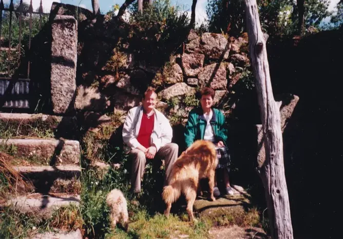
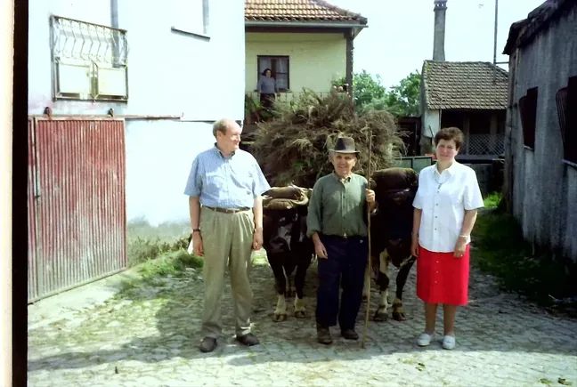
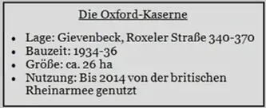
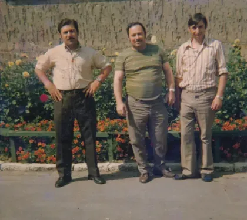
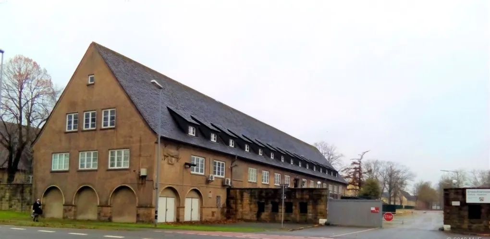
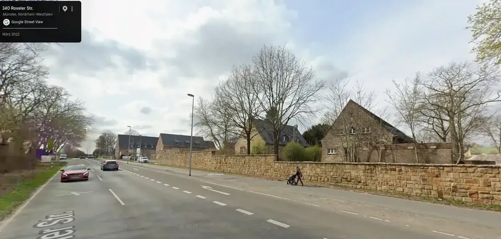

> Muitos temas que ainda vou completar, reestruturar e subdividir.

> Viele Themen, die ich noch vervollständigen, neu strukturieren und unterteilen werde.

## 🇵🇹 20 anos 

Durante cerca de 20 anos, falavam sempre em visitar Portugal, mas como não dominavam a língua e, nas aldeias rurais, praticamente não havia infraestruturas turísticas, o dia em que pudessem fazê-lo simplesmente nunca chegou.
Um dia, elaborei um plano juntamente com eles e garanti que o levassem a cabo.

**..., ... .** 

## 🇩🇪 20 Jahre 

Etwa 20 Jahre lang sprachen sie immer davon, Portugal zu besuchen, aber da sie die Sprache nicht beherrschten und es in den ländlichen Dörfern praktisch keine touristische Infrastruktur gab, kam der Tag, an dem sie dies tun konnten, einfach nie.

Eines Tages habe ich gemeinsam mit ihnen einen Plan ausgearbeitet und dafür gesorgt, dass sie ihn auch umsetzten.

Eu vivi e fui testemunha  deste mundo

**..., ... .**

### 🇵🇹 O "Tio" Agostinho 

Nas poucas conversas que tive com ele, contou-me muito sobre o aldeia de antigamente e uma  anedota sobre os mal-entendidos entre as culturas do seu tempo de trabalho na França.

Depois do trabalho, uma cerveja fresquinha e, ao almoço ou ao jantar, um bom vinho francês da adega – mas como é que se explica isto aos italianos?

E assim, durante toda a época, só bebeu cerveja.

---

**- Uma das últimas carros de gado "vacas" da aldeia.**

Quando o meu pai voltou definitivamente para Portugal, estava firmemente decidido a dar continuidade a esta tradição, mas acabou por ceder, porque o trator é mais cómodo.

**..., ... .** 

---

🇩🇪  In den wenigen Gesprächen, die ich mit ihm geführt habe, erzählte er mir viel über das Dorf von früher und eine Anekdote über die kulturellen Missverständnisse während seiner Arbeitszeit in Frankreich.

Nach der Arbeit ein kühles Bierchen und zum Mittag- oder Abendessen ein guter französischer Wein vom Weingut – aber wie sollte man das den Italienern erklären? 

Und so trank er die ganze Saison über nur Bier

---
**-  Einer der letzten Kuhwagen im Dorf.** "Ochsenkarren"

Als mein Vater nach Portugal ging, war er fest entschlossen, diese Tradition fortzuführen, gab aber schließlich nach, weil der Traktor bequemer ist.

**..., ... .** 

---
### Expo98

**..., ... .**  

**..., ... .**

---

### 🇵🇹 «Acidente ferroviário de Eschede»

Quando?

Quarta-feira, 3 de junho de 1998, das 10h00 às 10h15

 Acidente ferroviário de Eschede 

«Acidente ferroviário de Eschede» Eu estava em Portugal com o Hubert e a Anni Juckweg. Foi uma semana repleta de acontecimentos e reflexões posteriores. 

**..., ... .** 

Se não fosse o acidente, talvez nem tivesse voltado a saber dessa data. 

Naquela altura, decorria em Portugal a Expo 98 e, uma semana depois, parti na quarta-feira de comboio da meia-noite para visitar a Expo 98; devia regressar na sexta-feira à 01:00 da manhã e, depois, apanhar o comboio de Mangualde para Hendaye–Paris–Colónia.
Como havia uma greve e na sexta-feira eu …, … .

> Já escrevi sobre esta semana de forma mais detalhada; tenho de ver onde estão essas notas.

---
#### À distancia tudo é diferente

A minha tia Cacilda, que morreu (20xx? ) de cancro — creio que ainda antes de completar sessenta anos —, depois de ter conversado com alguns membros da família e eu corrigi o mal pensado ou suposto, ela disse: «Só isto? Para ti, devia ter sido muito,  muito mais mais.» 

**..., ... .** 

Sempre foi muito, muito menos , e não sei por que razão pensam que deveria ser muito, muito mais.

**..., ... .** 

Sei o que as pessoas pensavam; expliquei que não era assim, mas elas mantiveram a mesma atitude mesmo depois disso.

Uns dias antes desta semana e  esta semana, as memórias ainda estão tão vivas.

---
### À procura do Senhor  Pinto na Beira Alta

Fiquei a saber do acidente na quinta-feira de manhã. Estava a viajar de carro algures no distrito da Guarda e procurava no mapa uma pequena aldeia cujo nome já me escapou.

Partimos de manhã para visitar o Sr. Pinto — ou, melhor dizendo, para o procurar — e, como eles falavam com a Elke todas as noites, ficaram a saber do acidente e informaram-me disso na quinta-feira de manhã, enquanto eu conduzia.

**..., ... .** 

### **infos:**

#### Münster (NRW)

- 🇵🇹  Naquela altura, a região de Münster (Renânia do Norte-Vestefália) era a zona de ocupação militar britânica

- 🇩🇪 Zu jener Zeit war die Region Münster (Nordrhein-Westfalen) Teil der britischen Militärbesatzungszone

> **Penso** que o Senhor Pinto é o que está no meio.

### 🇵🇹 A Caserna de Oxford em Münster (NRW)

As três pessoas na fotografia e muitos outros civis alemães, portugueses e outros estrangeiros trabalhavam nas bases militares britânicas. Muitos deles viviam nos quartéis e regressaram mais tarde aos seus países de origem, depois de o governo alemão lhes ter proposto o pagamento de todas as pensões num único montante; no entanto, **com isso, perderam o direito a uma pensão de velhice alemã.**

#### Na altura, pouco, mas tentador; depois, nada

Naquela altura, na década de 80, em plena crise económica, aqueles que tinham descontado o mesmo  que o meu pai e aceitaram a oferta receberam cerca de 10.000 - 12 000 marcos, o que, em Portugal, na década de 80 marcada pela inflação, já representava uma quantia considerável. Quem aceitou a oferta ficou sem recursos no início dos anos 90 e deixou de ter direito a qualquer pensão.

10 000 – 12 000 marcos = 580 000  –  696 000 escudos

> Em agosto de 1983, ganhava 100 escudos por dia como ajudante na construção civil – os trabalhadores qualificados ganhavam entre 300 e 400 escudos por dia – ; e, em 1985, ganhava cerca de 200 a 300 escudos.

600 000 contos = 2 000 dias de trabalho a 300 escudos por dia = cerca de 9 anos de trabalho, a uma média de cerca de 230 dias úteis por ano.

> - Era assim que as pessoas faziam as contas naquela altura, e quem, na década de 90, tivesse investido toda a sua pensão num banco em Portugal, começou a perder o seu poder de compra anterior. 

O meu pai recebeu, de 1999 a dezembro de 2025, uma pensão da Alemanha no valor de entre cerca de 700 marcos (350 euros) e 430 euros. Isso corresponde, aproximadamente, a uma média de 400 euros por mês e resulta, ao longo desses anos, num total de cerca de 27 anos × 12 meses × 400 euros = 129 000 euros, em comparação com a oferta de 5 000 a 6 000 euros (10 000 – 12 000 marcos) na década de 80

Como dispunha de poupanças e possuía uma casa em Portugal, isso já era suficiente para cobrir as despesas de subsistência de duas pessoas (e, além disso, o apoio temporal das despesa basicas  de mais uma ou duas pessoas). A partir de 2007, as poupanças começaram a diminuir devido a doenças, mas, graças a duas pensões a partir de 2010, voltaram a ser suficientes para cobrir as despesas de subsistência.

---
### Razão porque é que eu em 2022  queria no inicio arrendar um canto para viver e depois comprar um palhal pequeno e renova-lo.

#### **Informações sobre a(s) casa(s)**

### A casa à esquerda

**A casa á esquerda**  onde vivem tem 15 m x 10 m. 

**Notas:** Nos últimos anos, não foram feitos investimentos na casa e muitas obras ficaram por concluir. Quem herdar a casa  tem, portanto, de investir, pelo menos, 50 000 euros; e para a tornar verdadeiramente confortável, serão necessários mais alguns  euros.

---
### A casa à direita

Casa à direita?

Desde 1983 não foi feito nada

Gostaria apenas de obter um orçamento geral, sem detalhes precisos, para tornar habitável a casa com a disposição indicada abaixo

**A casa do lado direito**  tem uma área útil de 15 m × 10 m e dispõe apenas de paredes de tijolo, que estão «tortas na escadaria interior», bem como portas exteriores e janelas danificadas «feitas de material de baixa qualidade dos anos 80» – mais nada. Tudo tem de ser renovado. Instalações elétricas e sanitárias

Distribuição da casa:
- 1 sala de estar
- 1 sala no sótão
- 3 quartos no primeiro andar
- 2 quartos no sótão
- 1 casa de banho grande no primeiro andar
- 1 casa de banho pequena no sótão
- 2 portas exteriores principais
- 2 portas exteriores para a sala de estar
- 13-14  portas interiores
- 9 janelas normais
- 2 janelas na casa de banho, que têm a mesma largura que 
- as janelas normais, mas são menos altas.
- 3 janelas de sótão "telhado" 
- 2 portas grandes de garagem no rés-do-chão
- 2 portas normais no rés-do-chão para a arrecadação.

Para tornar essa casa totalmente habitável partindo do estado em bruto (apenas paredes de tijolo, com necessidade de reboco, pavimentos, instalações e caixilharias novas), deve prever um **orçamento geral entre 180.000 € e 280.000 € (com IVA incluído)**, dependendo do nível de acabamentos escolhidos e da região de Portugal.

Com uma planta de **15 m × 10 m (150 m² por piso)** distribuída por rés-do-chão (garagem/arrecadação), primeiro andar e sótão aproveitado, trata-se de uma obra de reabilitação integral com cerca de **350 m² a 450 m² de área bruta total**.

Estimativa de Custos por Grandes Rubricas

Em Portugal, o custo de uma remodelação total em bruto situa-se atualmente entre **550 € e 850 € por m²** na área habitacional, e entre **250 € e 400 € por m²** nas zonas de garagem e arrumos:

|Rubrica da Obra|Descrição dos Trabalhos Previstos|Estimativa de Custo|
|---|---|---|
|**1. Alvenaria, Rebocos e Isolamento**|Correção das paredes tortas na escadaria, reboco interior/exterior, isolamento térmico (capoto/ETICS), betonilhas e tetos falsos (pladur).|**55.000 € – 85.000 €**|
|**2. Caixilharias, Portas e Garagem**|9 janelas + 2 janelas WC + 3 janelas de sótão (tipo Velux) em PVC/alumínio térmico, 4 portas exteriores, 13 portas interiores, 2 portões de garagem e 2 portas de arrecadação.|**30.000 € – 48.000 €**|
|**3. Instalações Técnicas (Água e Luz)**|Rede elétrica completa (quadros, cablagem, tomadas), canalização nova, esgotos, pré-instalação de climatização (AC) e aquecimento de águas (bomba de calor/painéis).|**25.000 € – 40.000 €**|
|**4. Revestimentos, Pinturas e Escadas**|Pavimentos (flutuante/cerâmico), azulejos nas 2 casas de banho e cozinha, revestimento da escadaria interior e pintura geral.|**30.000 € – 45.000 €**|
|**5. Cozinha e Casas de Banho**|Mobiliário de cozinha com eletrodomésticos básicos e loiças sanitárias, bases de duche, torneiras e móveis para as 2 casas de banho.|**18.000 € – 30.000 €**|
|**6. Projetos, Licenças e Imprevistos**|Licenciamento na Câmara Municipal (se alterar fachadas/telhado), projeto de especialidades e margem de segurança de 10 %.|**22.000 € – 32.000 €**|
|**TOTAL ESTIMADO (c/ IVA)**|**Obra chave na mão (gama média)**|**180.000 € – 280.000 €**|

Pontos Críticos a Ter em Conta no Seu Caso

- **Estado do telhado e estrutura.** Se a cobertura e a placa entre pisos estiverem em bom estado estrutural, o valor mantém-se dentro desta faixa. Caso seja necessário refazer o telhado ou reforçar vigas, deve somar entre **25.000 € e 45.000 €** ao orçamento.
- **Paredes tortas na escadaria.** A correção de aprumo na caixa de escadas exige mão de obra especializada em estuque ou revestimento em gesso cartonado (_pladur_), o que encarece ligeiramente os acabamentos interiores dessa zona.
- **Diferença regional de preços.** No interior do país (Norte e Centro interior), os valores aproximam-se mais do limite inferior (**180.000 € – 210.000 €**), enquanto no litoral, Grande Lisboa, Porto ou Algarve tendem para o limite superior (**240.000 € – 280.000 €**).
- **Benefício fiscal no IVA.** Se o imóvel estiver localizado numa **Área de Reabilitação Urbana (ARU)** e a obra for devidamente licenciada na Câmara Municipal, pode beneficiar da taxa reduzida de **6 % de IVA** em vez dos habituais 23 %, poupando dezenas de milhares de euros.

Se quiser afinar um pouco esta estimativa, diga-me:

- **Em que zona ou distrito** de Portugal fica a casa
- Qual é o estado atual do **telhado** (precisa de ser substituído ou está em boas condições?)
- Se pretende **acabamentos económicos** (para arrendamento/uso simples) ou de **gama média/alta** (habitação própria)

A casa situa-se no distrito de Viseu

A casa situa-se no distrito de Viseu, em Sátão; o telhado necessita de uma renovação completa, de preferência com materiais de gama média.

Para uma reabilitação integral em **Sátão (distrito de Viseu)**, incluindo a **substituição completa do telhado** e acabamentos de **gama média**, ==deve prever um orçamento global entre **195.000 € e 255.000 € (com IVA incluído)**==.

A localização no interior centro (Viseu/Sátão) ajuda a manter o custo da mão de obra mais competitivo do que no litoral, compensando em parte o investimento adicional exigido pelo novo telhado.

Estimativa Atualizada para Sátão (Gama Média + Telhado Novo)

Considerando uma planta de **15 m × 10 m (150 m² por piso)** e uma área de cobertura inclinada de aproximadamente **170 m² a 190 m²**, a distribuição dos custos fica assim:

|Rubrica da Obra|Detalhe para Sátão (Gama Média)|Estimativa de Custo|
|---|---|---|
|**1. Telhado Novo Completo**|Remoção do antigo, estrutura (madeira tratada ou vigotas), isolamento térmico (XPS/poliuretano), subtelha, telha cerâmica (tipo Lusa/Marselha) e caleiras.|**25.000 € – 38.000 €**|
|**2. Alvenaria, Rebocos e Isolamento**|Correção das paredes tortas na escadaria, reboco geral, isolamento térmico exterior (capoto) adequado ao inverno frio de Viseu e tetos falsos.|**45.000 € – 60.000 €**|
|**3. Caixilharias, Portas e Garagem**|9 janelas + 2 janelas WC + 3 janelas de sótão (vidro duplo térmico), 4 portas exteriores, 13 portas interiores, 2 portões de garagem e 2 portas de arrecadação.|**28.000 € – 38.000 €**|
|**4. Instalações Técnicas**|Rede elétrica completa, canalização e esgotos novos, bomba de calor para águas quentes (AQS) e pré-instalação de ar condicionado ou aquecimento.|**22.000 € – 32.000 €**|
|**5. Pavimentos, Azulejos e Pintura**|Flutuante ou cerâmico de gama média, revestimento das 2 casas de banho, acabamento da escadaria interior e pintura interior/exterior.|**28.000 € – 38.000 €**|
|**6. Cozinha e 2 Casas de Banho**|Móveis de cozinha de gama média (sem luxos), eletrodomésticos essenciais e equipamentos completos para as 2 casas de banho.|**17.000 € – 24.000 €**|
|**7. Licenças, Projetos e Imprevistos**|Licenciamento na Câmara Municipal de Sátão (obrigatório para alterar o telhado), direção de obra e margem de segurança de 10 %.|**20.000 € – 25.000 €**|
|**TOTAL ESTIMADO (c/ IVA)**|**Chave na mão com telhado novo**|**195.000 € – 255.000 €**|

Notas Importantes para a Região de Sátão

- **Isolamento térmico reforçado.** O distrito de Viseu tem invernos rigorosos e verões quentes. Investir num bom isolamento no telhado (mínimo 6 a 8 cm de placas XPS) e nas paredes exteriores (capoto) é essencial para evitar humidades e gastos elevados com aquecimento.
- **Licenciamento na Câmara Municipal de Sátão.** Como a obra envolve a renovação completa da cobertura e a substituição de caixilharias exteriores, será necessário submeter um projeto de arquitetura/comunicação prévia junto da autarquia antes de iniciar os trabalhos.
- **Benefício fiscal (ARU Sátão).** Verifique junto da Câmara Municipal de Sátão se o imóvel se encontra dentro de uma **Área de Reabilitação Urbana (ARU)**. Caso esteja, pode obter uma redução do IVA da empreitada de **23 % para 6 %**, além de isenções de IMI após a conclusão da obra.
- **Mão de obra local.** Na zona de Sátão e Viseu existem várias empresas de construção civil e serralharias locais com preços mais acessíveis do que empresas deslocadas de cidades maiores, mas os prazos de espera costumam rondar os 3 a 6 meses.

---

Um-buraco-sem-fim

Quem ficar com a casas terá de assumir, para além do pagamento das tornas (as partes dos restantes cinco herdeiros), um investimento elevado em obras antes de o imóvel ter valor de mercado ou habitabilidade. Na prática, esse custo de reabilitação deve ser descontado do valor teórico que a casa teria se estivesse pronta a habitar em Sátão.

#### Aspetos a Considerar nas Partilhas

- **Valor de mercado atual (em bruto).** Uma moradia inacabada dos anos 80 em Sátão vale apenas pelo terreno e pela estrutura existente, uma vez que o custo da obra quase iguala o valor final do imóvel pronto.
- **Despesas adicionais na escritura.** O herdeiro que ficar com a casa terá também de suportar o **IMT** (Imposto Municipal sobre as Transmissões Onerosas de Imóveis) e o **Imposto do Selo** sobre a parte que exceder o seu quinhão hereditário (os 5/6 adquiridos aos restantes irmãos/herdeiros), além dos custos de escritura e registo.
- **Avaliação independente.** Se houver divergências entre os seis herdeiros, pedir uma avaliação a um perito avaliador certificado da CMVM (custa cerca de 300 € a 500 €) ajuda a fechar acordo com base num número imparcial.

Para mobilar e equipar totalmente uma casa desta dimensão (**6 quartos, sala de estar, cozinha e 2 casas de banho**) partindo do zero, com mobiliário e acessórios de **gama média** em Portugal, deve somar um orçamento adicional entre **22.000 € e 36.000 € (com IVA incluído)**.

Somando este valor ao custo das obras (**195.000 € a 255.000 €**), o investimento total necessário para deixar a casa completamente pronta a morar situa-se entre **217.000 € e 291.000 €**.

Estimativa de Mobiliário e Acessórios (Gama Média)

Esta estimativa reflete preços típicos de lojas de referência em Portugal (como IKEA, Conforama, Jysk, Moviflor ou lojas locais de mobiliário da região de Viseu/Paços de Ferreira):

|Divisão / Categoria|Elementos Incluídos (Gama Média)|Estimativa de Custo|
|---|---|---|
|**1. Sala de Estar e Jantar**|Sofá de 3/4 lugares, mesa de jantar para 6 a 8 pessoas com cadeiras, móvel de TV, mesa de centro, aparador e tapetes.|**4.500 € – 7.500 €**|
|**2. Os 6 Quartos**|6 camas (casal/individuais) com estrados e colchões de boa qualidade, mesas de cabeceira, cómodas e roupeiros (caso não sejam embutidos na obra).|**9.000 € – 15.000 €**|
|**3. Cozinha e Lavandaria (Equipamento)**|Pequenos eletrodomésticos (micro-ondas, máquina de café, torradeira, aspirador), loiça, talheres, panelas, utensílios e máquina de lavar roupa.|**2.000 € – 3.500 €**|
|**4. Iluminação e Cortinados**|Candeeiros de teto e parede para toda a casa, lâmpadas LED, calhas/varões e cortinados ou estores interiores para as 14 janelas e portas envidraçadas.|**2.500 € – 4.000 €**|
|**5. Têxteis, Casas de Banho e Decoração**|Jogos de cama, edredons, almofadas, toalhas de banho, espelhos, acessórios de WC, quadros e artigos decorativos básicos.|**2.000 € – 3.000 €**|
|**6. Garagem e Arrecadação**|Estantes metálicas de arrumação, bancada básica de trabalho, ferramentas essenciais e caixotes de reciclagem.|**1.000 € – 1.500 €**|
|**7. Entrega e Montagem**|Custos de transporte até Sátão e serviço de montagem do mobiliário de maior porte.|**1.000 € – 1.500 €**|
|**TOTAL MOBILIÁRIO E ACESSÓRIOS**|**Casa equipada de raiz (gama média)**|**22.000 € – 36.000 €**|

Notas Importantes para a Negociação das Partilhas

- **Roupeiros embutidos.** Se o empreiteiro incluir roupeiros embutidos nos 6 quartos durante a fase de carpintaria da obra, pode reduzir o orçamento de mobiliário em cerca de **3.000 € a 5.000 €**.
- **Distinção jurídica nas partilhas.** Nas negociações entre herdeiros, o mobiliário e os acessórios não entram na avaliação patrimonial do imóvel (pois são bens móveis pessoais do futuro proprietário). Contudo, para quem vai ficar com a casa, este custo real pesa diretamente na sua capacidade financeira para pagar as tornas aos restantes cinco herdeiros.
- **Compra faseada.** Ao contrário das obras estruturais, o mobiliário dos 6 quartos pode ser adquirido gradualmente conforme a necessidade de utilização da casa.

----

Para apresentar aos restantes cinco herdeiros de forma clara e objetiva, este quadro resume o **esforço financeiro total** que espera quem ficar com a casa em Sátão (assumindo uma estimativa base de **60.000 €** para o valor atual do imóvel em bruto, apenas como exemplo ilustrativo para o cálculo das tornas e impostos).

1. Resumo Global do Investimento (Obras + Mobiliário)

Estes são os valores necessários para transformar a estrutura atual numa casa pronta a habitar (sem contar ainda com o pagamento aos herdeiros):

|Componente|Intervalo Estimado|Valor Médio de Referência|
|---|---|---|
|**Obras de Reabilitação Integral** _(inclui telhado novo, isolamento, caixilharias, luz, água, cozinha, 2 WC e licenças)_|195.000 € – 255.000 €|**225.000 €**|
|**Mobiliário e Equipamento** _(gama média para sala, 6 quartos, iluminação, cortinados e acessórios)_|22.000 € – 36.000 €|**29.000 €**|
|**SUBTOTAL (Tornar a casa habitável)**|**217.000 € – 291.000 €**|**254.000 €**|

---

2. Simulação das Partilhas (6 Herdeiros) e Impostos na Aquisição

Em Portugal, nas partilhas por herança, o herdeiro que fica com o imóvel paga apenas impostos (**IMT** e **Imposto do Selo**) sobre a parte que compra aos outros herdeiros — neste caso, **5/6 (83,33 %)** do valor atribuído à casa.

O quadro abaixo mostra três cenários possíveis para o valor acordado da casa no estado atual (em bruto):

|Rubrica das Partilhas|Cenário A: Casa avaliada em **45.000 €**|Cenário B: Casa avaliada em **60.000 €**|Cenário C: Casa avaliada em **90.000 €**|
|---|---|---|---|
|**Quota de cada herdeiro (1/6)**|7.500 €|10.000 €|15.000 €|
|**Tornas a pagar aos outros 5 herdeiros (5/6)**|**37.500 €**|**50.000 €**|**75.000 €**|
|**Imposto do Selo (0,8 % sobre 5/6)**|300 €|400 €|600 €|
|**IMT (Habitação Secundária sobre 5/6)** _(taxa de 1 % até 101.917 €)_|375 €|500 €|750 €|
|**Escritura e Registo Predial** _(estimativa)_|~ 800 €|~ 850 €|~ 950 €|
|**TOTAL A PAGAR NAS PARTILHAS**|**~ 38.975 €**|**~ 51.750 €**|**~ 77.300 €**|

_(Nota: Se o herdeiro declarar a casa como **Habitação Própria e Permanente**, fica isento de IMT até cerca de 101.917 € na parte adquirida, poupando o valor indicado na linha do IMT)._

---

3. Esforço Financeiro Total para Quem Fica com a Casa

Somando as despesas das partilhas aos custos médios para tornar a casa habitável (**254.000 €**):

- **No Cenário A (casa a 45.000 €).** Investimento total de **~ 293.000 €** (38.975 € de partilhas + 254.000 € de obras e recheio).
- **No Cenário B (casa a 60.000 €).** Investimento total de **~ 305.750 €** (51.750 € de partilhas + 254.000 € de obras e recheio).
- **No Cenário C (casa a 90.000 €).** Investimento total de **~ 331.300 €** (77.300 € de partilhas + 254.000 € de obras e recheio).

Argumento-Chave para a Reunião de Herdeiros

- **Valor final de mercado.** Em Sátão, uma moradia usada ou remodelada desta dimensão vale no mercado entre **220.000 € e 280.000 €**. Como as obras e o mobiliário já consomem praticamente esse valor, atribuir um preço demasiado alto à estrutura atual em bruto torna o negócio financeiramente inviável para qualquer um dos seis herdeiros.

---

### A casa à esquerda

Orçamento para a casa à esquerda e faltam as janelas, telhodo e etc

Für einen kompletten Satz aus **9 Fensterrollläden und 2 Türrollläden** (insgesamt 11 Elemente) inklusive Lieferung und Montage in Portugal solltest du je nach Material und Antrieb mit Gesamtkosten von **ca. 2.500 € bis 5.800 € (inkl. 23 % IVA)**rechnen.

In Portugal sind Außenrollläden (_estores exteriores_) aus ausgeschäumtem Aluminium (_alumínio térmico_) der gängige Standard, da sie im Sommer effektiv vor Hitze schützen.

Geschätzte Gesamtkosten nach Ausstattung (11 Rollläden)

Die folgende Kalkulation basiert auf aktuellen portugiesischen Marktpreisen für Material und Montage

|Position / Variante|9 Fensterrollläden (ca. 1,20 × 1,40 m)|2 Türrollläden (ca. 1,00 × 2,20 m)|Geschätzte Gesamtsumme (inkl. Montage)|
|---|---|---|---|
|**1. Manuell (Gurt / _Fita_)**   Aluminium thermisch|ca. 180 – 260 € / Stk.|ca. 240 – 340 € / Stk.|**ca. 2.100 € – 3.020 €**|
|**2. Elektrisch (Wand-Taster)**   Aluminium thermisch + Rohrmotor|ca. 320 – 450 € / Stk.|ca. 400 – 550 € / Stk.|**ca. 3.680 € – 5.150 €**|
|**3. Elektrisch (Funk / Solar)**   Aluminium thermisch + Fernbedienung|ca. 400 – 550 € / Stk.|ca. 480 – 650 € / Stk.|**ca. 4.560 € – 6.250 €**|

Wichtige Preisfaktoren in Portugal

- **Austausch vs. Komplettsystem.** Wenn bereits Rollladenkästen (_caixas de estore_) vorhanden sind und nur Panzer, Welle und Führungsschienen getauscht werden, sinkt der Preis um etwa 25 bis 35 Prozent gegenüber kompletten Vorbau- oder Aufsatzkästen (_estores compactos_).
- **Elektroarbeiten (_abertura de roços_).** Bei der Umrüstung von manuellen auf elektrische Rollläden müssen oft Schlitze in die Wand gestemmt werden, falls noch kein Stromanschluss am Kasten liegt. Hierfür berechnen Elektriker meist zusätzlich **50 € bis 100 € pro Fenster**.
- **Mehrwertsteuer (IVA).** Auf neue Rollläden und die Montage fallen in Portugal regulär **23 % IVA** an. Bei bestimmten energetischen Sanierungen an selbstgenutzten Wohngebäuden kann für den reinen Arbeitslohn der reduzierte Steuersatz von **6 % IVA** greifen.

So holst du verbindliche Angebote in Portugal ein

Da ich als KI kein rechtsverbindliches Handwerkerangebot ausstellen kann, erreichst du über diese Wege schnell Fachbetriebe vor Ort:

- **Online-Handwerkerportale.** Über Plattformen wie Fixando oder kannst du eine kostenlose Anfrage für deine Region einstellen und erhältst innerhalb weniger Tage mehrere Vergleichsangebote lokaler Fachfirmen.
- **Baumärkte mit Montageservice.** Große Ketten wie bieten ein Aufmaß und einen detaillierten Kostenvoranschlag (_orçamento_) vor Ort an (oft gegen eine Pauschale von ca. 30 €, die bei Auftragserteilung verrechnet wird).
- 

---

---

### 🇩🇪 Die Oxford-Kaserne

Foto da internet

Die Oxford-Kaserne

Die drei Personen auf dem Foto und viele andere portugiesische, deutsche und ausländische Zivilisten arbeiteten auf den britischen Militärstützpunkten. Viele von ihnen wohnten in den Kasernen und kehrten später in ihre Heimatländer zurück, nachdem die deutsche Regierung ihnen angeboten hatte, alle Rentenbezüge als Einmalzahlung auszuzahlen; allerdings verloren sie dadurch ihren Anspruch auf eine deutsche Altersrente.

Damals wenig, aber verlockend; danach nichts

#### Damals wenig, aber verlockend; danach nichts

Damals, in den 80er Jahren, mitten in der Wirtschaftskrise, erhielten diejenigen, die im gleichen Zeitraum wie mein Vater gearbeitet hatten und das Angebot annahmen, etwa 12.000 Mark, was in Portugal in den von Inflation geprägten 80er Jahren bereits eine beträchtliche Summe darstellte. Wer das Angebot annahm, war Anfang der 90er Jahre mittellos und hatte keine Rentenansprüche mehr. 

**10.000–12.000 Mark = 580.000 – 696.000 Escudos**

> - Im August 1983 verdiente ich im Baugewerbe als Hilfsarbeiter 100 Escudos – Facharbeiter verdienten 300 bis 400 Escudos pro Tag – ; und 1985 verdiente ich etwa 200 bis 300 Escudos.

600.000 Contos = 2.000 Arbeitstage à 300 Escudos pro Tag = etwa 9 Jahre Arbeit bei etwa 230 Arbeitstagen pro Jahr.

> So haben die Leute damals gerechnet, und wer in den 90er Jahren seine gesamte Rente bei einer Bank in Portugal angelegt hatte, begann, seine frühere Kaufkraft zu verlieren.

🇵🇹 Entrei aqui duas vezes entre outubro e dezembro de 1985, mas naquela altura éramos revistados pelos militares à entrada, embora fosse uma revista pouco rigorosa.

> Por volta do ano de 2005, passei de ônibus (BUS10) ao lado  e as muros estavam protegidas com arame farpado. Consequências do 11 de setembro. Em 1985, ainda não havia tantas medidas de segurança. E agora, depois de todos os investimentos, acabaram por desmontar tudo novamente

#### A Residencias de muitos Portugueses  – A Caserna Oxford – 

Quem tinha procurado outro lugar para viver continuava a vir aqui para visitar o cabeleireiro da  terra natal. Um corte de cabelo fora destes muros custava cerca de 10 a 14 marcos – em 1992, paguei 16 marcos por um corte de cabelo –, mas dentro destes muros no cabeleireiro da terra natal, um corte de cabelo custava cerca de 5 marcos. Eu ganhava 3,5 marcos – 1,75 euros – na agricultura. Ou seja, tinha de trabalhar uns 90 minutos para poder pagar um corte de cabelo de 20 minutos. Se tivesse ido cortar o cabelo fora destes muros, teria de trabalhar pelo menos 200 minutos para poder pagar um corte de cabelo de 20 minutos.

---

Infos

## **Infos:**

#### 🇵🇹 **DM em escudos.**

- Na média anual de ***1985***, **1 marco alemão** valia cerca de **57,92 escudos**
- - **100 escudos em marcos alemães.** Em termos de conversão, 100 escudos custavam, em média anual, cerca de **1,73 marcos alemães** (exatamente 1,7266 marcos alemães).

- Em **dezembro** de ***1984***, a taxa de câmbio média mensal situava-se em **1 marco alemão = cerca de 53,89 escudos**
-  - 100 escudos = aprox. 1,86 DM) e subiu até
- **dezembro de 1986** para **1 DM = aprox. 74,75 escudos** (ou seja, )
- - 100 escudos = cerca de 1,34 DM. O marco alemão valorizou-se quase 39 por cento face à moeda portuguesa nestes dois anos.

- ***1992-2002*:**   1 DM = cerca de 100 escudos

A 1 de janeiro de 1999, ambas as moedas foram irrevogavelmente indexadas ao euro (1 EUR = 1,95583 DM ou 1 EUR = 200,482 PTE), o que, no final da união monetária, resultou numa relação fixa de 1 DM = 102,505 escudos

 #### Em 1985, um corte de cabelo no cabeleireiro da aldeia custava cerca de 100 escudos;

**Portugal**

 **Contas:**  3,5 Marcos por hora  =   210 Escudos por 60 minutos de trabalho.
 Um  corte de cabelo  de 20 Minutos  na aldeia em Portugal custava-me 
 > 100/210x60 = **28, 5 Minutos** de trabalho na Alemanha.

 **Contas:**  3,5 Marcos por hora  =   210 Escudos por 60 minutos de trabalho 
 Um  corte de cabelo  de 20 Minutos para turistas, alentejanos  e transmontanos em Lisboa ou no  Algarve  em Portugal custava
 > (200 a  300)/210x60 = ca. **57 a 85  Minutos**  de trabalho na Alemanha.
 
**Alemanha**

 **Contas:**  3,5 Marcos por hora  =   60 minutos de trabalho.
 Um  corte de cabelo  de 20 Minutos  dentro das muralhas da caserna custava-me 
 > 5 DM /3,5DM x 60 min = **85, 7 Minutos** de trabalho na Alemanha.

 **Contas:**  3,5 Marcos por hora  =  60 minutos de trabalho.
 Um  corte de cabelo  de 20 Minutos para turistas, alentejanos , transmontanos  e para  todos os outros que se perderam pela Alemanha custava um corte de cabelo  fora das muralhas da caserena 14 - 18 DM e 
 
 Se eu cortasse o cabelo fora das muralhas ** tinha que trabalhar  240 a 300  para isso.**   
 
 > 14 a 18 DM /3,5DM x 60 min = ca. **240  a 300  Minutos** =  4 a  5 horas de trabalho na Alemanha.
 
1985: *Um turista português, que trabalhava em Portugal como ajudante na construção civil, ganhava menos de 500 escudos (1985) por dia e perdeu-se por acaso na Alemanha. Como não queria ser confundido com os «Gandulos» que fumavam marijuana, foi ao cabeleireiro para aparar o cabelo e teve de trabalhar para pagar o serviço*

##### Cálculos

- Corte de cabelo: 14–18 DM = 812–1044 escudos

- Salário diário: 500 escudos por 8 horas de trabalho ou 480 minutos por dia  

> 812 a 1044 escudos / 500 escudos x 480 min. = aprox. **779,52 a 1000 minutos** de trabalho em Portugal

Resumo:

- Um corte de cabelo para turistas em Portugal custova, em 1985, **57 a 85 minutos de trabalho** na Alemanha

- Um corte de cabelo na Alemanha, fora do Muro, custava  em 1985, **780 a 1000 minutos de trabalho em Portugal.**

***E foi precisamente esta relação que se fixou na memória coletiva de Portugal. No entanto, as circunstâncias mudaram radicalmente.***

#### 🇵🇹 Corte de cabelo

**Alemanha**

> **Corte de cabelo simples para homens

- 1985: → 5 DM no cabeleireiro dentro das muralhas da Caserna (lá fora ****aprox. 14 – 18 DM** )
- 1991: → 16 DM no cabeleireiro junto à esquadra da polícia em Wpt-Langerfeld
- 2020:  → 9–10 euros em  Wpt-Vohwinkel
- 2026: → 14 euros

**Portugal**

> Corte de cabelo simples para homens

- 1985:  **cerca de 200–350 PTE**  –para turistas, alentejanos  e transmontanos que se perderam em Lisboa ou no Algarve–
> - 1985:  **cerca de 100 PTE** –na aldeia–
- 1991/1992:→ **cerca de 200–300 PTE** –na aldeia–
- 2023/24: → **9 euros** / Viseu «Cabeleireiro experiente»
- 2025: → 16  euros / Algarve, no cabeleireiro da esquina
- 2026: → 20 euros  / Lisboa, no cabeleireiro da esquina.

#### Os cabeleireiros independentes da esquina

Investiram dinheiro numa máquina de cortar cabelo e depois perguntam ao cliente se este quer um corte com tesoura, sem saberem manejá-la, e depois queixam-se de que um corte de cabelo em Munique é caro e custa «30 euros»; quando lhe disse que o meu último corte de cabelo na Alemanha tinha custado 14 euros, a tesoura ficou tímida e o corte deixou muito a desejar.

DM in Escudos

#### **DM in Escudos**

- Im Mittelwert des Jahres ***1985*** erhielt man für **1 D-Mark** etwa **57,92 Escudos**
- - **100 Escudos in DM.** Umgerechnet kosteten 100 Escudos im Jahresmittel etwa **1,73 DM** (exakt 1,7266 DM).

- Im **Dezember** ***1984*** lag der Wechselkurs im Monatsdurchschnitt bei **1 DM = ca. 53,89 Escudos** 
-  - 100 Escudos = ca. 1,86 DM) und stieg bis 
- **Dezember 1986** auf **1 DM = ca. 74,75 Escudos** (bzw. )
- - 100 Escudos = ca. 1,34 DM Die D-Mark wertete in diesen zwei Jahren gegenüber der portugiesischen Währung um fast 39 Prozent auf.

- ***1992-2002*:**   1 DM = ca. 100 Escudos
Zum 1. Januar 1999 wurden beide Währungen unwiderruflich an den Euro gekoppelt (1 EUR = 1,95583 DM bzw. 1 EUR = 200,482 PTE), was zum Ende der Währungsunion einem festen Verhältnis von 1 DM = 102,505 Escudos 

*Ein portugiesischer Tourist, der in Portugal als Hilfsarbeiter auf dem Bau arbeitete, etwa 500 Escudos (1985) pro Tag verdiente und sich zufällig in Deutschland verirrte und nicht wollte, dass man ihn mit den „Gandulos“ verwechselte, die Marihuana rauchten und deshalb zum Friseur gingen, um sich die Haare schneiden zu lassen, musste arbeiten*

##### Berechnungen

- Haarschnitt:  14–18 DM = 812–1044 Escudos
-  Tageslohn: 500 Escudos für 8 Arbeitsstunden oder 480 Minuten pro Tag

 >  812 bis 1044 Escudos  / 500 Escudos  x  480 Min.  = ca. **779,52  bis 1000  Minuten**  Arbeit in Portugal

Zusammenfassung:
- Ein Haarschnitt für Touristen in Portugal kostete mich 1985 **57 bis 85 Arbeitsminuten** in Deutschland
-  Ein Haarschnitt in Deutschland außerhalb der Mauern kostete mich 1985 **780 bis 1000 Arbeitsminuten in  Portugal.**

***Und genau dieses Verhältnis hat sich im kollektiven Gedächtnis Portugals festgesetzt. Doch die Verhältnisse haben sich radikal verändert.***

#### Haarschnitt

**Deutschland**

> **Einfacher Haarschnitt für Männer

- 1985: → 5 DM beim Friseur innerhalb der Mauern  (außerhalb ****ca. 14 – 18 DM** )
- 1991: → 16 DM beim Friseur neben der Polizeiwache in Wpt-Langerfeld
- 2020:  → 9–10 Euro in  Wpt-Vohwinkel
- 2026: → 14 Euro

**Portugal**

> Einfacher Herrenhaarschnitt

- 1985:  **ca. 200–350 PTE**  –für Touristen und Einwohner von Trás-os-Montes, die sich in Lissabon oder an der Algarve verlaufen haben –
- - 1985:  **ca. 100 PTE** –im Dorf–
- 1991/1992:→ **ca. 200–300 PTE** –im Dorf–
- 2023/24: → **9 Euro** / Viseu „Erfahrener Friseur“
- 2025: → 16  Euro / Algarve, beim Friseur an der Ecke
- 2026: → 20 Euro  / Lissabon, beim Friseur an der Ecke.
#### Die selbstständigen Friseure an der Ecke

Sie haben Geld in eine Haarschneidemaschine investiert und fragen den Kunden dann, ob er einen Schnitt mit der Schere möchte, ohne mit dieser umgehen zu können, und beschweren sich anschließend, dass ein Haarschnitt in München teuer sei und „30 Euro“ koste; als ich ihm sagte, dass mein letzter Haarschnitt in Deutschland 14 Euro gekostet habe, wurde die Schere schüchtern und die Schnittführung ließ zu wünschen übrig.

---
#### 🇵🇹 **O Alojamento**

O que não sei é se os trabalhadores tinham um quarto individual ou um quarto partilhado.
Quem vivia aqui conseguia ainda poupar algum dinheiro, mas quem tinha um apartamento na cidade universitária de Münster mal lhe restava dinheiro para comer depois de pagar a renda
#### Recusaram

Em 1993, o meu pai arranjou trabalho aos meus cunhados numa empresa de jardinagem não muito longe daqui; no entanto, eles não aceitaram a oferta e, como tudo já estava organizado e se esperavam dois trabalhadores, foram, em vez deles, o Carlos, o primo do meu cunhados, e outro senhor de Lamas. Não ganhavam tanto quanto esperavam e viviam numa casa que partilhavam com outros trabalhadores de outros países e que era regularmente inspecionada por uma senhora idosa, para garantir que não se empilhassem montes de panelas na cozinha. Como o estilo de vida e o que ganhavam não correspondiam às suas expectativas, trabalharam lá apenas durante uma época.

---

---
### 🇩🇪  Die Oxford-Kaserne em Münster

Ich war zwischen Oktober und Dezember 1985 zweimal hier, aber damals wurden wir am Eingang vom Militär durchsucht, auch wenn diese Kontrolle nicht besonders streng war.

Wer sich einen anderen Wohnort gesucht hatte, kam weiterhin hierher, um den Friseur aus seiner Heimat zu besuchen. Ein Haarschnitt außerhalb dieser Mauern kostete etwa 10 bis 14 Mark – 1992 zahlte ich 16 Mark für einen Haarschnitt –, aber innerhalb dieser Mauern beim Friseur aus der Heimat kostete ein Haarschnitt etwa 5 Mark. Ich verdiente 3,5 Mark – 1,75 Euro – in der Landwirtschaft. Das heißt, ich musste 90 Minuten arbeiten, um mir einen 20-minütigen Haarschnitt leisten zu können. Wäre ich außerhalb dieser Mauern zum Friseur gegangen, hätte ich mindestens 200 Minuten arbeiten müssen, um mir einen 20-minütigen Haarschnitt leisten zu können.

#### Die Unterkunft

Was ich nicht weiß, ist, ob die Arbeiter ein Einzelzimmer oder ein Mehrbettzimmer hatten.
Wer hier wohnte, konnte noch etwas Geld sparen, aber wer eine Wohnung im Studentenviertel von Münster hatte, dem blieb nach Zahlung der Miete kaum noch Geld zum Essen übrig

#### Sie lehnten ab

1993 vermittelte mein Vater meinen Schwägern eine Stelle bei einer Gartenbaufirma unweit von hier; sie nahmen das Angebot jedoch nicht an, und da bereits alles organisiert war und zwei Arbeiter erwartet wurden, gingen stattdessen Carlos, der Cousin meines Schwageres, und ein weiterer Herr aus Lamas. Sie verdienten nicht so viel, wie sie erwartet hatten, und wohnten in einem Haus, das sie sich mit anderen Arbeitern aus anderen Ländern teilten und das regelmäßig von einer älteren Dame kontrolliert wurde, um sicherzustellen, dass sich in der Küche keine Berge von Töpfen stapelten. Da der Lebensstil und das, was sie verdienten, nicht ihren Erwartungen entsprachen, arbeiteten sie dort nur eine Saison lang.

Das ist eindeutig die **Oxford-Kaserne** (Roxeler Straße 340–370 in Gievenbeck). 

Ihre Erinnerungen passen bis ins kleinste Detail zusammen:

- **Verbindung mit der Buslinie 10.** Bis Ende der 1970er-Jahre fuhr die Buslinie 10 von der Innenstadt aus genau bis zur Endhaltestelle an der **Oxford-Kaserne**. Erst danach wurde die Linie weiter bis nach Roxel verlängert und fuhr ab diesem Zeitpunkt direkt an der Kaserne vorbei.

**Lage auf dem Weg nach Roxel.** Die Kaserne lag direkt an der **Roxeler Straße**, der Hauptverbindungsachse zwischen der Münsteraner Innenstadt (über Gievenbeck) und Roxel.

- **Unterbringung von Arbeitern.** Auf dem riesigen Gelände bzw. in den Randbereichen und Nebengebäuden des ehemaligen Militärareals (das ursprünglich 1934–1936 als Flakartillerie-Kaserne gebaut wurde) befanden sich über Jahrzehnte hinweg auch zivile Unterkünfte und Wohnheime, darunter das bis in die jüngere Zeit genutzte **Arbeiterwohnhaus**. 

Nachdem die britischen Streitkräfte die Oxford-Kaserne 2013 als letzten Standort in Münster geräumt haben, wird das 26 Hektar große Areal seit 2019 zum neuen Wohngebiet  **Oxford-Quartier** umgebaut. Einige der markanten roten Backsteingebäude aus der Kasernenzeit (wie das Torhaus oder das ehemalige Offizierskasino) sind dabei erhalten geblieben

..., ... . 

---

### Expo98

..., ... 

---

### „Zugunglück von Eschede“

Wann?

Mittwoch, 3. Juni 1998, 10:00 – 10:15 Uhr

„Zugunglück von Eschede“ Ich war mit Hubert und Anni Juckweg in Portugal. Es war eine Woche voller Ereignisse und nachträglicher Überlegungen. 

..., ... . 

Meine Tante Cacilda, die an Krebs starb – ich glaube, noch bevor sie sechzig Jahre alt wurde –, sagte, nachdem sie sich mit einigen Familienmitgliedern ausgetauscht hatte: „Nur das? Für dich hätte es mehr sein müssen.“ 
..., ... . 

Das war schon immer so, und ich weiß nicht, warum es mehr sein sollte.

..., ... . 

Ich weiß, was die Leute dachten; ich erklärte, dass es nicht so sei, aber sie behielten auch in Zukunft dieselbe Haltung bei. Vor dieser Woche und in dieser Woche sind die Erinnerungen noch lebendig.

Ich erfuhr am Donnerstagmorgen von dem Unfall. Ich war gerade als Fahrer irgendwo im Distrikt Guarda unterwegs und suchte auf der Karte nach einem kleinen Dorf, dessen Namen ich bereits vergessen habe.
 Wir brachen am Morgen auf, um herauszufinden, ob Herr Pinto noch am Leben war. 
..., ... . 

Wäre da nicht der Unfall gewesen, hätte ich das Datum vielleicht gar nicht mehr in Erfahrung gebracht. 

Zu dieser Zeit fand in Portugal die Expo 98 statt, und ich fuhr eine Woche später mit dem Mitternachtszug am Mittwoch los, um die Expo 98 zu besuchen; ich sollte den Zug am Freitag um 01:00 Uhr morgens zurück nehmen und dann den Zug von Mangualde nach Hendaye–Paris–Köln nehmen.

Da es einen Streik gab und ich …, … .

> Ich habe über diese Woche bereits ausführlicher darüber geschrieben, ich muss mal nachsehen, wo sich diese Notizen befinden.

