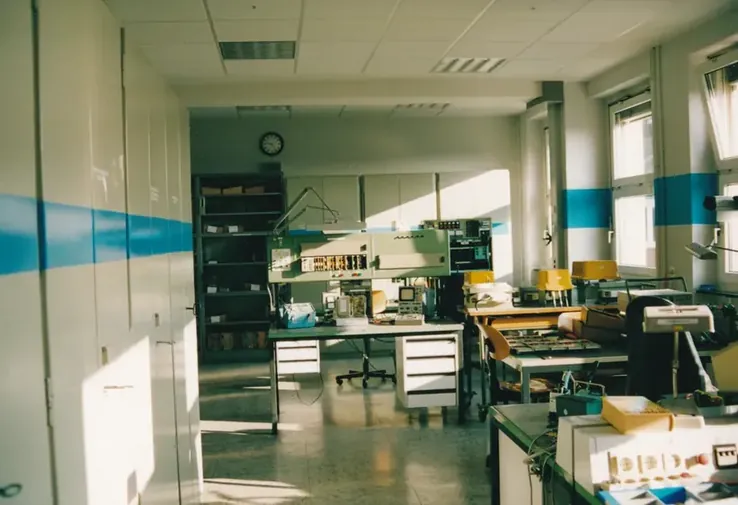

[Index](Index.md)
### 🇩🇪 Nine Eleven

_Tage, die das Leben prägen – nicht nur weltweit, sondern auch im Umgang mit den Kollegen am Arbeitsplatz._

911

Ich erinnere mich noch genau an diesen Tag. Als ich in meiner Wohnung ankam, schaltete ich wie gewohnt den Fernseher ein. Wie immer warf ich zuerst einen Blick auf die aktuellen Nachrichten im Videotext, damals meine wichtigste Informationsquelle.

Das erste Bild, das ich sah, zeigte Flugzeuge, die in die Twin Towers stürzten. Im ersten Moment dachte ich, es handle sich um eine Szene aus einem dieser typischen amerikanischen Filme. Doch als ich den Videotext aufrief, las ich, was tatsächlich geschehen war.

Ich glaube, in diesem Augenblick blockierte mein Verstand. Es war, als würde er sich weigern, das Gesehene zu akzeptieren oder überhaupt zu begreifen. In den folgenden Tagen begann ich nachzudenken – oder besser gesagt, die Informationen und ihre Tragweite langsam auf mich wirken zu lassen. Ich wusste zunächst nicht, was ich davon halten sollte. Alles erschien unwirklich, beinahe surreal.

Dabei erinnerte ich mich an kleine Holzklötze von etwa 25 × 25 × 120 mm, die unter anderem dazu dienten, die Relais der EAA-Baugruppe während des Transports zu sichern. Und ich erinnerte mich an unsere Freizeitgestaltung während der Mittagspause von 11:30 bis 12:00 Uhr – insbesondere an den Bau unserer Türme.

#### Die Vorgeschichte

Vor dem 11. September, dem Nine Eleven, spielten wir während der Mittagspausen meistens zwei oder drei Runden Skat. Danach war die Stimmung allerdings gelegentlich etwas getrübt.

### Die Holzklötze – was lässt sich damit anfangen?

Die Holzklötze mit den Abmessungen von etwa 25 × 25 × 110 mm gehörten zu einer Holzkonstruktion, die auch eine Holzpalette von ungefähr 110 × 70 × 5 mm umfasste. Ihre Aufgabe bestand darin, die vier großen Relais innerhalb der EAA-Baugruppe während des Transports zu fixieren und so für die notwendige Transportsicherheit zu sorgen.

Wenn eine EAA-Baugruppe zur Reparatur zurückkam, sammelten sich mit der Zeit immer mehr dieser Holzklötze an. Sie konnten anschließend nicht mehr wiederverwendet werden.

Da das Holz unbehandelt war und keine Chemikalien enthielt, kam jemand auf die Idee, dass es sich hervorragend eignen würde, damit die Kinder irgendwelche Konstruktionen bauen könnten.

So entstand während unserer Mittagspausen ein kleiner Wettbewerb: Wer schaffte es, den höchsten Wolkenkratzer zu bauen?

Als Unterlage dienten die Transportwagen, die wir normalerweise auch als Tisch für unsere Skatrunden benutzten.

S. H. baute einen Wolkenkratzer, und ich machte mich ebenfalls ans Werk. Um meine Konstruktion noch höher erscheinen zu lassen, baute ich kurzerhand einen zweiten Turm daneben und verband beide mit Querbalken – einer Art Brücke zwischen den beiden Gebäuden. So entstanden unsere Twin Towers.

Währenddessen filmte A. H. das Geschehen. Als schließlich der Transportwagen bewegt wurde, stürzte die gesamte Konstruktion in sich zusammen. Auch dieser Augenblick wurde auf Video festgehalten, damit wir uns später einmal an diese guten alten Zeiten erinnern konnten.

Es waren unbeschwerte Zeiten, in denen das Miteinander während der Mittagspausen noch ganz entspannt war.

**Dann kam der 11. September.**

**Ich erinnerte mich an das Video und bat A. H., es zu löschen.** 

Angesichts der Tragödie, die sich mit unserem damaligen Zeitvertreib auf so makabre Weise verbinden ließ, war das Video für mich nicht mehr die Erinnerung an ein harmloses Spiel. Was vorher ein unbeschwerter Spaß gewesen war, hatte plötzlich einen völlig anderen Beigeschmack bekommen.

Danach sagte ich nichts mehr dazu. Ich weiß bis heute nicht, ob er das Video tatsächlich gelöscht hatte.

Als er mich fast ein Jahr später fragte, ob ich mir das Video ansehen wolle, erinnerte ich ihn daran, dass ich ihn bereits gebeten hatte, es zu löschen. Damit war das Thema für mich erledigt, und wir sprachen nicht weiter darüber.

Ob er das Video zu diesem Zeitpunkt bereits gelöscht hatte oder ob er lediglich meine Reaktion testen wollte, weiß ich bis heute nicht.

Jedenfalls begann damit eine Veränderung. Die zuvor entspannten Mittagspausen gehörten allmählich der Vergangenheit an. Irgendwann ging ich dazu über, während der Pause die Füße auf den Arbeitstisch zu legen, Kopfhörer aufzusetzen und Musik zu hören. Ich schloss die Augen, um mich auszuruhen und für einen Moment abzuschalten.

Um 11:59 Uhr war meine Pause beendet, und ich widmete mich wieder meiner Arbeit.

**Seit dem 11. September war nichts mehr so wie zuvor.**

---
### 🇵🇹 Nine Eleven

_Dias que marcam a vida – não apenas à escala mundial, mas também na forma como nos relacionamos com os colegas no local de trabalho._

911

Ainda me lembro perfeitamente daquele dia. Quando cheguei a casa, liguei a televisão, como fazia habitualmente. A primeira coisa que consultava eram sempre as notícias mais recentes no teletexto, que naquela altura constituía a minha principal fonte de informação.

A primeira imagem que vi mostrava aviões a embater nas Torres Gémeas. No primeiro instante, pensei que se tratasse de uma cena de um daqueles típicos filmes americanos. Mas, quando consultei o teletexto, li o que realmente tinha acontecido.

Acredito que, naquele momento, a minha mente bloqueou. Era como se se recusasse a aceitar ou sequer a compreender aquilo que estava a ver. Nos dias seguintes, comecei a refletir – ou melhor, a deixar que as informações e a dimensão do acontecimento fossem lentamente assimiladas. Inicialmente, nem sabia bem o que pensar. Tudo parecia irreal, quase surreal.

Ao mesmo tempo, lembrei-me de pequenos blocos de madeira, com cerca de 25 × 25 × 120 mm, que, entre outras coisas, serviam para fixar os relés do conjunto EAA durante o transporte. E lembrei-me também daquilo que fazíamos nos nossos tempos livres durante a pausa de almoço, entre as 11h30 e as 12h00 – em particular, da construção das nossas torres.

#### Os antecedentes

Antes do 11 de setembro, o Nine Eleven, costumávamos jogar duas ou três partidas de Skat durante a pausa de almoço. Depois, porém, o ambiente ficava por vezes um pouco mais pesado.

### Os blocos de madeira – o que se pode fazer com eles?

Os blocos de madeira, com dimensões aproximadas de 25 × 25 × 110 mm, faziam parte de uma estrutura de madeira que incluía também uma palete com cerca de 110 × 70 × 5 mm. A sua função era manter fixos os quatro grandes relés no interior do conjunto EAA durante o transporte, garantindo assim a segurança necessária.

Quando um conjunto EAA regressava para reparação, estes blocos de madeira começavam a acumular-se com o passar do tempo. Já não podiam ser reutilizados.

Como a madeira não tinha sido tratada com produtos químicos, alguém teve a ideia de que seria ideal para as crianças construírem todo o tipo de estruturas.

Assim nasceu, durante as nossas pausas de almoço, uma pequena competição: quem conseguiria construir o arranha-céus mais alto?

As construções eram feitas sobre os carrinhos de transporte, que também utilizávamos como mesa para jogar Skat.

S. H. construiu um arranha-céus e eu também comecei a construir o meu. Para o tornar ainda mais alto, decidi construir uma segunda torre ao lado da primeira e uni-las com travessas, formando uma espécie de ponte entre os dois edifícios. E assim nasceram as nossas Twin Towers.

Entretanto, A. H. estava a filmar tudo. Quando o carrinho de transporte foi movimentado, toda a construção desabou. Esse momento também ficou registado em vídeo, para que mais tarde pudéssemos recordar os bons velhos tempos.

Eram tempos descontraídos, em que o convívio durante as pausas de almoço ainda decorria de forma bastante informal e agradável.

**Depois chegou o 11 de setembro.**

**Lembrei-me do vídeo e pedi a A. H. que o apagasse.** 

Perante a tragédia que, de uma forma tão macabra, passou a estar associada à nossa antiga brincadeira, aquele vídeo deixou de representar para mim a recordação de um simples divertimento. Aquilo que antes tinha sido uma atividade inocente e descontraída adquirira subitamente um significado completamente diferente.

Depois disso, não voltei a falar no assunto. Até hoje, não sei se ele chegou realmente a apagar o vídeo.

Quando, quase um ano mais tarde, me perguntou se queria ver o vídeo, lembrei-lhe que já lhe tinha pedido para o apagar. Para mim, o assunto ficou encerrado e não voltámos a falar sobre ele.

Ainda hoje não sei se, nessa altura, já tinha apagado o vídeo ou se apenas queria testar a minha reação.

De qualquer forma, foi a partir daí que começou uma mudança. As pausas de almoço, que até então tinham sido descontraídas, foram gradualmente ficando para trás. A certa altura, comecei a aproveitar esse tempo de outra maneira: colocava os pés sobre a mesa de trabalho, punha os auscultadores e ouvia música. Fechava os olhos para descansar e desligar-me por alguns momentos.

Às 11h59, a minha pausa terminava e voltava ao trabalho.

**Desde o 11 de setembro, nada voltou a ser como antes.**

---
### 🇪🇸 Nine Eleven

_Días que marcan la vida, no solo a escala mundial, sino también en la forma de relacionarnos con los compañeros en el lugar de trabajo._

911

Todavía recuerdo perfectamente aquel día. Cuando llegué a casa, encendí el televisor, como hacía habitualmente. Lo primero que consultaba siempre eran las noticias de actualidad en el teletexto, que por aquel entonces constituía mi principal fuente de información.

La primera imagen que vi mostraba aviones estrellándose contra las Torres Gemelas. En un primer momento pensé que se trataba de una escena de una de esas típicas películas estadounidenses. Pero, cuando consulté el teletexto, leí lo que realmente había sucedido.

Creo que, en aquel instante, mi mente se bloqueó. Era como si se negara a aceptar o siquiera a comprender lo que estaba viendo. Durante los días siguientes empecé a reflexionar o, mejor dicho, a dejar que la información y la magnitud de lo ocurrido fueran calando poco a poco. Al principio no sabía muy bien qué pensar. Todo parecía irreal, casi surrealista.

Al mismo tiempo, recordé unos pequeños bloques de madera de aproximadamente 25 × 25 × 120 mm que, entre otras cosas, servían para asegurar los relés del conjunto EAA durante el transporte. También recordé lo que hacíamos durante nuestro tiempo libre en la pausa del mediodía, entre las 11:30 y las 12:00, especialmente la construcción de nuestras torres.

#### Los antecedentes

Antes del 11 de septiembre, el Nine Eleven, solíamos jugar dos o tres partidas de Skat durante las pausas del mediodía. Después, sin embargo, el ambiente quedaba a veces un poco enrarecido.

### Los bloques de madera: ¿qué se puede hacer con ellos?

Los bloques de madera, de unas dimensiones aproximadas de 25 × 25 × 110 mm, formaban parte de una estructura de madera que incluía también un palé de aproximadamente 110 × 70 × 5 mm. Su función era mantener sujetos los cuatro grandes relés dentro del conjunto EAA durante el transporte, garantizando así la seguridad necesaria.

Cuando un conjunto EAA regresaba para ser reparado, con el paso del tiempo se iban acumulando cada vez más bloques de madera. Ya no podían reutilizarse.

Como aquella madera no había sido tratada con productos químicos, a alguien se le ocurrió que sería ideal para que los niños construyeran todo tipo de estructuras.

Así surgió, durante nuestras pausas del mediodía, una pequeña competición: ¿quién sería capaz de construir el rascacielos más alto?

Las construcciones se levantaban sobre los carros de transporte, que también utilizábamos como mesa para jugar al Skat.

S. H. construyó un rascacielos y yo también me puse manos a la obra. Para hacerlo aún más alto, decidí construir una segunda torre junto a la primera y unir ambas mediante unas vigas transversales, formando una especie de puente entre los dos edificios. Y así nacieron nuestras Twin Towers.

Mientras tanto, A. H. estaba grabándolo todo. Cuando movieron el carro de transporte, toda la construcción se vino abajo. Aquel momento también quedó registrado en vídeo para que, más adelante, pudiéramos recordar los buenos viejos tiempos.

Eran tiempos distendidos, en los que la convivencia durante las pausas del mediodía todavía era relajada y agradable.

**Entonces llegó el 11 de septiembre.**

**Me acordé del vídeo y le pedí a A. H. que lo borrara.** 

Ante la tragedia que, de una forma tan macabra, pasó a estar relacionada con nuestro antiguo pasatiempo, aquel vídeo dejó de representar para mí el recuerdo de un simple entretenimiento. Lo que antes había sido una actividad inocente y despreocupada adquirió de repente un significado completamente distinto.

Después de aquello, no volví a decir nada. Hasta hoy no sé si realmente llegó a borrar el vídeo.

Cuando, casi un año más tarde, me preguntó si quería verlo, le recordé que ya le había pedido que lo borrara. Para mí, el asunto quedó zanjado y no volvimos a hablar de ello.

A día de hoy sigo sin saber si para entonces ya había borrado el vídeo o si simplemente quería poner a prueba mi reacción.

En cualquier caso, a partir de ahí empezó a producirse un cambio. Las pausas del mediodía, que hasta entonces habían sido momentos distendidos, fueron quedando poco a poco atrás. Llegó un momento en que empecé a aprovechar ese tiempo de otra manera: apoyaba los pies sobre la mesa de trabajo, me ponía los auriculares y escuchaba música. Cerraba los ojos para descansar y desconectar durante unos instantes.

A las 11:59 terminaba mi pausa y volvía al trabajo.

**Desde el 11 de septiembre, nada volvió a ser como antes.**

---
### 🇬🇧 Nine Eleven

_Days that shape our lives – not only on a global scale, but also in the way we relate to our colleagues at work._

911

I still remember that day very clearly. When I arrived home, I switched on the television, as I normally did. The first thing I always checked was the latest news on teletext, which at the time was my main source of information.

The very first image I saw showed aeroplanes crashing into the Twin Towers. For a moment, I thought it was a scene from one of those typical American films. But when I checked the teletext, I read what had actually happened.

I believe my mind simply froze at that moment. It was as though it refused to accept or even comprehend what I had just seen. Over the following days, I began to reflect – or, more accurately, to let the information and the magnitude of the events slowly sink in. At first, I really did not know what to make of it. Everything seemed unreal, almost surreal.

At the same time, I remembered the small wooden blocks, measuring approximately 25 × 25 × 120 mm, which, among other things, were used to secure the relays of the EAA assembly during transportation. I also remembered how we used to spend our free time during the lunch break, from 11:30 to 12:00 – particularly building our towers.

#### The background

Before September 11, Nine Eleven, we usually played two or three rounds of Skat during our lunch breaks. Afterwards, however, the atmosphere was sometimes a little subdued.

### The wooden blocks – what can you do with them?

The wooden blocks, measuring approximately 25 × 25 × 110 mm, were part of a wooden structure that also included a wooden pallet measuring roughly 110 × 70 × 5 mm. Their purpose was to secure the four large relays inside the EAA assembly during transportation, ensuring that everything remained safely in place.

Whenever an EAA assembly was returned for repair, more and more of these wooden blocks accumulated over time. They could no longer be reused.

Since the wood had not been treated with chemicals, someone came up with the idea that it would be ideal for children to use to build all kinds of structures.

And so, during our lunch breaks, a little competition began: who could build the tallest skyscraper?

We used the transport trolleys as building platforms. These were also the same trolleys we used as tables when playing Skat.

S. H. built a skyscraper, and I started building one too. To make mine even taller, I decided to construct a second tower alongside the first and connect the two with crossbeams, creating something like a bridge between the buildings. And that was how our Twin Towers came into being.

Meanwhile, A. H. was filming everything. When the transport trolley was moved, the entire construction came crashing down. That moment was captured on video too, so that we could look back on those good old days sometime in the future.

They were carefree times, when getting along with one another during lunch breaks was still easy and relaxed.

**Then came September 11.**

**I remembered the video and asked A. H. to delete it.** 

In the light of the tragedy, which had now become connected with our former pastime in such a macabre way, the video no longer represented a simple, harmless game to me. Something that had once been innocent fun had suddenly taken on an entirely different meaning.

After that, I said nothing more about it. To this day, I do not know whether he actually deleted the video.

When he asked me almost a year later whether I wanted to watch it, I reminded him that I had already asked him to delete it. As far as I was concerned, that settled the matter, and we never discussed it again.

To this day, I do not know whether he had already deleted the video by then or whether he simply wanted to test my reaction.

In any case, that was when things began to change. The relaxed atmosphere during our lunch breaks gradually became a thing of the past. At some point, I started spending my breaks differently: I would put my feet up on the workbench, put on my headphones and listen to music. I closed my eyes to rest and switch off for a little while.

At 11:59, my break was over, and I returned to work.

**From September 11 onwards, nothing was ever quite the same again.**

---

EAA

### Baugruppen des Achszählers 65** 

- **Ein- und Ausgabe (EA).** Die Baugruppe empfing die Impulse der Zählpunkte von draußen und gab das Ergebnis als sicheres Signal an das Stellwerk weiter.
- **Achszähler (A).** Durch das angehängte „A“ ließ sich die Baugruppe im Relaisschrank sofort eindeutig dem Achszählsystem zuordnen und von anderen Ein- und Ausgabebaugruppen (etwa für Weichen oder Signale) unterscheiden.
- **Schnittstellenfunktion.** Genau dort saßen dann auch die vier großen Relais, um die empfindliche Germanium-Elektronik des Zählwerks sicher vom Rest der Stellwerksanlage zu trennen.

#### Die EAA-Gruppe

Da die genaue interne Bauteilbezeichnung für den historischen Achszähler Az 65 von Standard Elektrik Lorenz (später Alcatel SEL) online nicht mehr vollständig dokumentiert ist, lassen sich die üblichen Kürzel dieser Technikgeneration wie folgt einordnen:

- **Ein- und Ausgabe-Achszählers.** In der damaligen Relaistechnik und frühen Halbleitertechnik von SEL bildete die Baugruppe die Schnittstelle zwischen den empfindlichen elektronischen Zählstufen und der Außen- bzw. Stellwerksanlage.

- **Relais-Schnittstelle.** Die von Ihnen erwähnten vier großen Relais auf einem der Module übernahmen die galvanische Trennung und schalteten die sicheren Gleisfreimelde- oder Störungskontakte (wie die Gleishilfsrelais) für das Stellwerk durch, da die damaligen Germanium-Transistoren keine hohen Lasten treiben konnten.

- **Temperaturempfindlichkeit.** Die Ende der 1960er-Jahre verbauten Germanium-Halbleiter (wie etwa die bekannten OC- oder AC-Typen) neigten bei höheren Umgebungstemperaturen stark zu Leckströmen, was in den Relaisräumen der Stellwerke oft eine aufwendige Temperaturkompensation oder Kühlung erforderte.

---

[Index](../Index.md)

