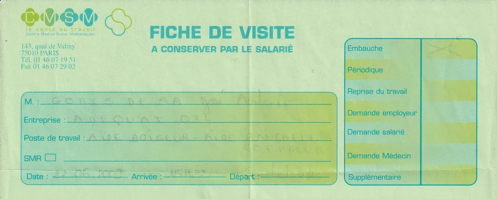
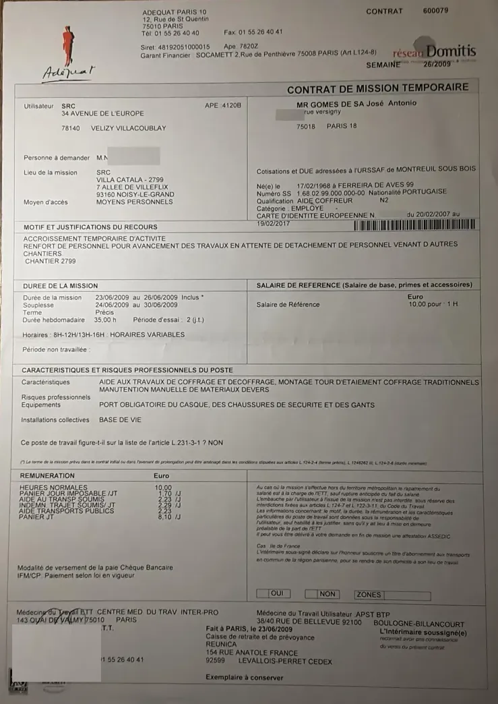
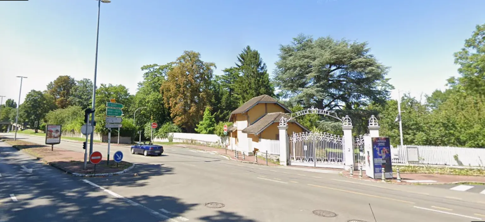
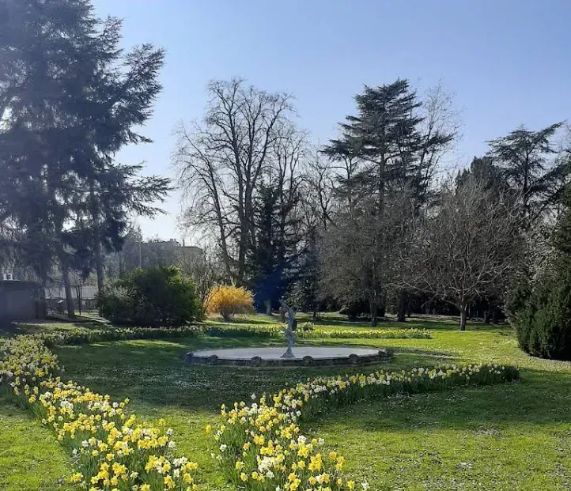
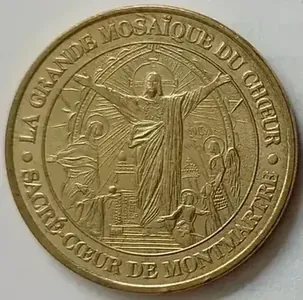

### 🇩🇪  Ein Monat in Paris

- **Zeitraum:** Sonntag, 28. Juni 2009, 08:00 Uhr – Freitag, 17. Juli 2009, 16:00 Uhr
    
Fast einen Monat lang arbeitete ich in der Villa Cathala. Nach Feierabend war der "Bois de Vincennes" mein Lieblingsort, um abzuschalten und mich zu entspannen.

Am Sonntagmorgen, noch bevor Paris richtig erwachte, machte ich mich auf den Weg nach Montmartre und besuchte die Messe in der Basilika Sacré-Cœur. In den frühen Morgenstunden, bevor sich dieser besondere Ort mit seinem herrlichen Blick über Paris mit Touristen und Straßenkünstlern füllte, konnte man die Atmosphäre noch in aller Ruhe genießen.

Auch der Park der Villa Cathala war während der Mittagspausen ein wunderbarer Ort zum Entspannen – vielleicht sogar der angenehmste Pausenort, den ich während meines gesamten Arbeitslebens erlebt habe. An diesen heißen Sommertagen suchte ich mir ein schattiges Plätzchen, schloss einfach die Augen und genoss die Ruhe und den kühlen Schatten der Bäume.

---
#### 🇵🇹 Um mês em Paris 

- **Período:** Domingo, 28 de junho de 2009, às 08h00 – sexta-feira, 17 de julho de 2009, às 16h00

Trabalhei durante quase um mês na Villa Cathala e, depois do trabalho, o Bois de Vincennes tornou-se o meu lugar preferido para descontrair e relaxar.

Na manhã de domingo, ainda antes de Paris despertar, fui dar um passeio até Montmartre e participei na missa na Basílica do Sacré-Cœur. Nas primeiras horas da manhã, antes de aquele lugar especial, com a sua magnífica vista sobre Paris, se encher de turistas e artistas de rua, ainda era possível desfrutar tranquilamente do ambiente.

O parque da Villa Cathala também era um lugar maravilhoso para relaxar durante as pausas para o almoço – talvez o local mais agradável para fazer uma pausa que alguma vez tive ao longo da minha vida profissional. Naqueles dias quentes de verão, procurava um lugar à sombra, fechava simplesmente os olhos e desfrutava da tranquilidade e da frescura proporcionadas pelas árvores.

#### 🇪🇸 Un mes en París

- **Periodo:** Domingo, 28 de junio de 2009, a las 08:00 – viernes, 17 de julio de 2009, a las 16:00
    
Trabajé durante casi un mes en la Villa Cathala y, al terminar la jornada laboral, el Bois de Vincennes se convirtió en mi lugar favorito para desconectar y relajarme.

El domingo por la mañana, cuando París todavía no había despertado del todo, fui dando un paseo hasta Montmartre y asistí a la misa en la Basílica del Sacré-Cœur. A primera hora de la mañana, antes de que aquel lugar tan especial, con sus magníficas vistas sobre París, se llenara de turistas y artistas callejeros, todavía se podía disfrutar tranquilamente de su ambiente.

El parque de la Villa Cathala también era un lugar maravilloso para relajarse durante las pausas del almuerzo; quizá el lugar más agradable para descansar que he conocido a lo largo de toda mi vida laboral. Durante aquellos calurosos días de verano, buscaba un rincón a la sombra, simplemente cerraba los ojos y disfrutaba de la tranquilidad y del frescor de los árboles.

#### 🇬🇧 A Month in Paris

- **Period:** Sunday, 28 June 2009, 08:00 – Friday, 17 July 2009, 16:00

I worked at the Villa Cathala for almost a month, and after work, the Bois de Vincennes became my favourite place to unwind and relax.

On Sunday morning, before Paris had properly woken up, I went for a walk to Montmartre and attended Mass at the Basilica of Sacré-Cœur. In the early hours, before this special place, with its magnificent views over Paris, filled up with tourists and street performers, it was still possible to enjoy the atmosphere in peace and quiet.

The park at the Villa Cathala was also a wonderful place to relax during lunch breaks – perhaps the most pleasant place to take a break that I have ever experienced throughout my working life. On those hot summer days, I would find a shady spot, simply close my eyes and enjoy the peace and the cool shade of the trees.

---

### Villa Cathala - Maison des arts

> **2 Allée de Maintenon, 93160 Noisy-le-Grand, Frankreich**

🇩🇪 Villa Cathala

#### Vom Landsitz zum Haus der Künste

Die **Villa Cathala – Maison des Arts** in Noisy-le-Grand ist ein schönes Beispiel dafür, wie ein historisches Anwesen erhalten und einer neuen kulturellen Nutzung zugeführt werden kann. Besonders interessant ist ihre Geschichte als ehemalige private Sommerresidenz und ihre spätere Umwandlung in einen öffentlichen Kulturort.

Die Villa Cathala wurde 1869 während des Zweiten Kaiserreichs als repräsentative, italienisch inspirierte Villa auf dem ehemaligen Anwesen Villeflix in Noisy-le-Grand errichtet. Sie entstand vermutlich in der Nähe des früheren Schlosses Villeflix, das im 19. Jahrhundert verschwand. Ursprünglich trug sie den Namen _Villa Le Lac_, in Anlehnung an die Wasserfläche, die den damaligen Park schmückte.

In den 1920er-Jahren wurde das Gebäude durch seitliche Anbauten erweitert. 1945 erwarb Charles Cathala das Anwesen, nach dem die Villa später benannt wurde.

Die Stadt Noisy-le-Grand erwarb das historische Gebäude 1999/2000, um es vor dem Verfall zu bewahren. Nach umfangreichen Restaurierungsarbeiten wurde es 2010 als _Maison des Arts et des Associations_ wiedereröffnet.

Heute dient die Villa als kultureller Treffpunkt mit Kunstausstellungen, Workshops und Begegnungen mit Künstlern. Auch der weitläufige, baumbestandene Park gehört zum besonderen Charakter dieses historischen Ortes.

---

🇵🇹 Villa Cathala

#### 🇵🇹 De residência de campo a Casa das Artes

A **Villa Cathala – Maison des Arts**, em Noisy-le-Grand, é um belo exemplo de como é possível preservar uma propriedade histórica e dar-lhe um novo uso cultural. A sua história, enquanto antiga residência privada de verão e a sua posterior conversão num espaço cultural público, reveste-se de especial interesse.

A Villa Cathala foi construída em 1869, durante o Segundo Império francês, como uma elegante residência de inspiração italiana, na antiga propriedade de Villeflix, em Noisy-le-Grand. Foi erguida provavelmente nas proximidades do antigo castelo de Villeflix, desaparecido no século XIX. Inicialmente, recebeu o nome de _Villa Le Lac_, em referência à extensão de água que embelezava o parque da propriedade.

Na década de 1920, o edifício foi ampliado com duas alas laterais. Em 1945, Charles Cathala adquiriu a propriedade, dando posteriormente o seu nome à villa.

A Câmara Municipal de Noisy-le-Grand adquiriu o edifício histórico em 1999/2000, com o objetivo de preservar o seu património arquitetónico. Após importantes obras de recuperação, foi reaberto em 2010 como _Maison des Arts et des Associations_.

Atualmente, a villa é um espaço de encontro cultural, acolhendo exposições de arte, oficinas e encontros com artistas. O seu parque arborizado também faz parte do encanto deste lugar histórico.

---

🇪🇸 Villa Cathala

#### De residencia de campo a Casa de las Artes

La **Villa Cathala – Maison des Arts**, en Noisy-le-Grand, es un bonito ejemplo de cómo se puede conservar una finca histórica y darle un nuevo uso cultural. Resulta especialmente interesante su historia como antigua residencia privada de verano y su posterior conversión en un espacio cultural público.

La Villa Cathala fue construida en 1869, durante el Segundo Imperio francés, como una elegante residencia de inspiración italiana en la antigua finca de Villeflix, en Noisy-le-Grand. Se levantó probablemente cerca del antiguo castillo de Villeflix, desaparecido en el siglo XIX. Inicialmente recibió el nombre de _Villa Le Lac_, en referencia a la extensión de agua que embellecía el parque de la propiedad.

En la década de 1920, el edificio fue ampliado con dos alas laterales. En 1945, Charles Cathala adquirió la propiedad, cuyo nombre acabaría llevando la villa.

El Ayuntamiento de Noisy-le-Grand adquirió el edificio histórico en 1999/2000 con el objetivo de preservar su patrimonio arquitectónico. Tras importantes trabajos de restauración, reabrió sus puertas en 2010 como _Maison des Arts et des Associations_.

Actualmente, la villa es un espacio de encuentro cultural que acoge exposiciones de arte, talleres y encuentros con artistas. Su parque arbolado también forma parte del encanto de este lugar histórico.

---

🇬🇧  Villa Cathala

#### From Country Residence to House of the Arts

The **Villa Cathala – Maison des Arts**, in Noisy-le-Grand, is a fine example of how a historic property can be preserved and given a new cultural purpose. Its history as a former private summer residence and its subsequent conversion into a public cultural space is particularly interesting.

Villa Cathala was built in 1869, during the Second French Empire, as an elegant Italian-inspired residence on the former Villeflix estate in Noisy-le-Grand. It was probably constructed near the former Château de Villeflix, which disappeared during the nineteenth century. Originally, the villa was called _Villa Le Lac_, a reference to the stretch of water that adorned the estate's park.

During the 1920s, the building was enlarged with two lateral extensions. In 1945, Charles Cathala acquired the property, and the villa eventually took his name.

The municipality of Noisy-le-Grand acquired the historic building in 1999/2000 to preserve its architectural heritage. Following extensive restoration work, it reopened in 2010 as the _Maison des Arts et des Associations_.

Today, the villa serves as a cultural meeting place, hosting art exhibitions, workshops and encounters with artists. Its tree-filled park is also an integral part of the charm of this historic property.

---

### Basilika Sacré-Cœur

#### Basilique du Sacré-Cœur de Montmartre

2009-06

   

---
#### Bois de Vincennes

- Porte Dorée

---

[Index](../Index.md)